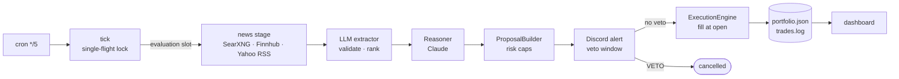

# stockmanager

**An LLM reads the news, proposes trades, and you get a veto window before anything fills.**

    

> **⚠️ Disclaimer.** This project is a **research and simulation tool only**. It does not connect to any brokerage, execute real trades, or hold or move real money, and nothing it produces — including fills, valuations, signals, rankings, or LLM-generated reasoning — is investment, financial, legal, or tax advice or a recommendation or solicitation to buy, sell, or hold any security. The author is not a registered investment adviser, broker-dealer, or financial institution, and no advisory or fiduciary relationship is created by using this software. Simulated results are hypothetical, do not reflect real-world execution (slippage, liquidity, fees, taxes), and are not indicative of future performance. Market data from third-party sources (e.g. Yahoo Finance via `yfinance`, Finnhub) and news content may be delayed, incomplete, or inaccurate, is provided without any warranty, and remains subject to those providers' terms; the LLM component is experimental and may produce incorrect, fabricated, or misleading output.
>
> **Do not use this software to make real investment decisions.** It is provided under the [MIT License](LICENSE) **"AS IS", without warranty of any kind**, express or implied, including merchantability, fitness for a particular purpose, accuracy, and non-infringement. To the maximum extent permitted by law, the author and contributors shall not be liable for any claim, loss, or damages — including trading or investment losses, lost profits, or data errors — arising from the use of or inability to use this software, even if advised of the possibility of such damages. You are solely responsible for your decisions; consult a licensed financial professional before acting on any financial matter.

## What it does

A semi-autonomous **mock** portfolio manager. No real money and no brokerage: every fill is simulated against real session prices.

Once a week (Saturday 09:00 PT by default) it pulls news for every holding, has Claude reason over the extracted facts, and turns the result into risk-capped proposals. Each proposal is posted to Discord with a veto window (4 h by default). Anything you don't veto fills at the next session open, 06:30 PT. Every fill lands in `portfolio.json` and an audit `trades.log`, and the dashboard is rebuilt.

## How it works



The tick is stateless. What is due (evaluation, sweeps, executions, expiries) is derived from the books on every run, so a missed tick self-heals.

## Key features

- **Real-time pricing.** Yahoo Finance via `yfinance` (file-cached, batched), Finnhub as fallback. One source per valuation, never mixed. If neither can price everything, the portfolio is left unchanged.
- **News aggregation.** SearXNG, Finnhub and Yahoo RSS fetched in parallel, normalised, then reduced to ranked facts by an LLM extractor. Prices scraped from text are never used as a price source.
- **LLM reasoning.** Claude via the Anthropic API behind an `LLMBackend` protocol.
- **Discord control.** Alerts, veto window, `VETO` / `APPROVE` / `PAUSE` / `STATUS` and more. The CLI runs the same handlers, so nothing depends on the bot being up.
- **File-based state.** No database. Atomic writes (tmp, fsync, rename), `flock` locking, and reconciliation of `portfolio.json` against `trades.log`. Money is `Decimal`, never `float`.
- **Session-aware scheduling.** NYSE holidays and 13:00 ET early closes from `data/calendars/nyse.json`; fails closed outside the covered range.
- **Tested offline.** 1215 tests, 93% coverage, `ruff` and `mypy --strict` clean. Protocol seams plus `sim/` fakes with fault injection.

## Architecture

Code lives in `src/stockmanager/`. Domain models and ports are kept apart from adapters, and `app.py` is the composition root.

| Module | Role |
|---|---|
| `scheduler/` | `tick`, due-job derivation, watchdog, sweeper |
| `news/` | plan, fetch, normalise, extract, validate, rank |
| `evaluation/` | `EvaluationEngine`, `Reasoner`, `ProposalBuilder`, reconfirm |
| `execution/` | `ExecutionEngine`: simulated fills and ledger commits |
| `pricing/`, `adapters/` | `PriceService` (fail-closed); yfinance, Finnhub, calendar, Discord REST |
| `store/` | `FileStore`, atomic writes, locks, transactions, reconcile |
| `notify/`, `bot/`, `commands/` | Outbox delivery, Discord daemon, shared CLI/Discord handlers |
| `domain/`, `llm/`, `sim/` | Models and ports, LLM backends, test doubles |
| `dashboard/`, `config/`, `ops/` | HTML/JSON report, hot-reloaded config, `doctor` |

Specs: [`architecture-spec.md`](architecture-spec.md) · [`automated-portfolio-system-spec.md`](automated-portfolio-system-spec.md) · [`testing-spec.md`](testing-spec.md) · [`user-experience-spec.md`](user-experience-spec.md)

## Getting started

```bash
make dev                      # create .venv, install deps and the pre-commit hook
# keys in ~/.config/stockmanager/secrets.env:
#   ANTHROPIC_API_KEY, FINNHUB_API_KEY, DISCORD_BOT_TOKEN   (SEARXNG_URL defaults to localhost:8080)
stockmanager init             # create workspace/
stockmanager status           # LIVE, cash, positions, pending proposals
stockmanager bot              # Discord daemon (optional; the CLI works without it)
```

Schedule the heartbeat with [`ops/crontab.example`](ops/crontab.example) (every 5 minutes) or the launchd plist alongside it, then verify with `stockmanager doctor`. Full operator guide: [`docs/user-manual.md`](docs/user-manual.md).

## Quality

| Check | Command | Result |
|---|---|---|
| Tests | `make test` | 1215 passed in ~23 s |
| Coverage | `pytest --cov=stockmanager` | 93% statements ([baseline](docs/coverage-baseline.md)) |
| Lint | `make lint` | `ruff` and `mypy --strict` clean; enforced in CI and by a pre-commit hook |

Known gaps are tracked in [`docs/project-postmortem.md`](docs/project-postmortem.md).

## License

[MIT](LICENSE)
