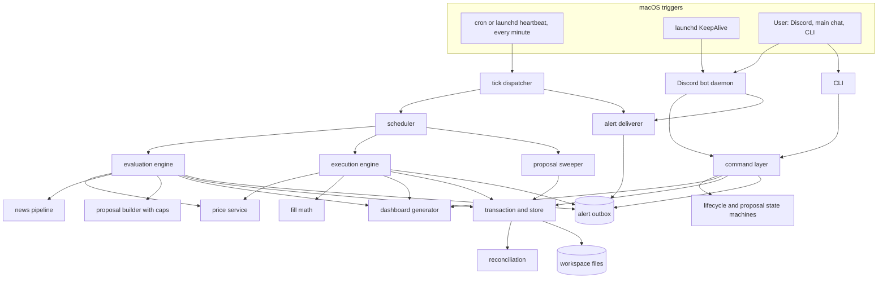
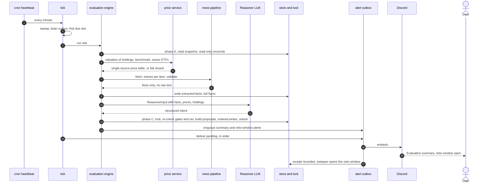
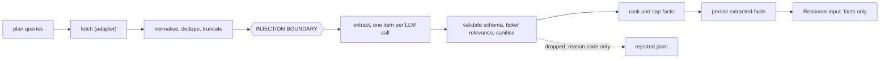
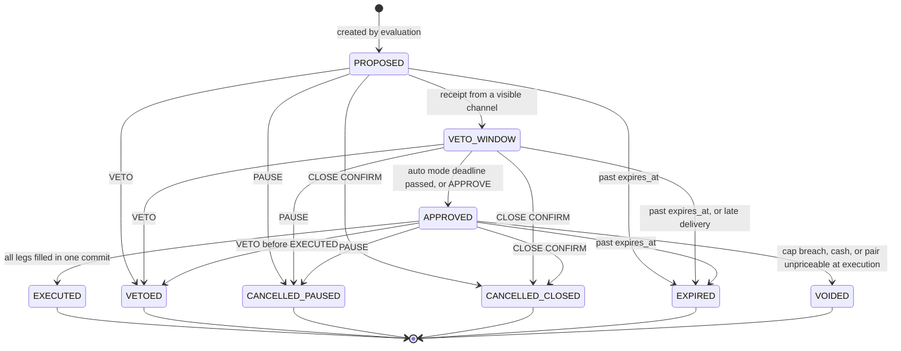

# Automated Portfolio System — Architecture Specification

**Companion to:** `automated-portfolio-system-spec.md` (**SS §n**), `user-experience-spec.md` (**UX §n**), `testing-spec.md` (**TS §n**; its numbered decisions are cited **TS D1–D19**). Rules and behaviours are referenced, not restated. This document says *how the code is built*; where it extends or deviates from a companion spec, the deviation is tagged **⚑AD#** and listed in Section 14 for confirmation.

**Status:** Draft — for review before implementation.
**Audience:** the developer who will write the code. Every schema, interface and path below is intended to be implemented as written. Where something is unresolved it is listed in Section 14.2, not guessed.

**Money:** none. No brokerage, no order routing, no credentials for either (SS §1). Nothing in this architecture may add one.

---

## 0. Design principles

These are the rules the rest of the document applies. When two designs both satisfy the specs, the one that follows more of these wins.

| # | Principle | Consequence in the design |
|---|---|---|
| P1 | **The books are files, and there is one write protocol.** | Every mutation of `portfolio.json`, `trades.log`, `proposals/`, config goes through one `Transaction` object (§8.5). Nothing else may open those files for writing. |
| P2 | **Pure core, thin adapters.** | Decision logic (sizing, caps, reconcile, metrics, state machines, command parsing) is pure Python over plain data. Network, Discord, LLM, clock and filesystem sit behind Protocols (§12.1) so every non-negotiable can be tested without them. |
| P3 | **Gates live in code, at the lowest layer that can enforce them.** | Caps, lifecycle gates, authorization and the injection boundary are enforced by functions the engines cannot bypass — not by prompt text (SS §8.5). |
| P4 | **Fail closed, leave the books unchanged.** | Any doubt (price, lock, reconcile, schema, clock) ends the job with no write and an alert. |
| P5 | **LLMs sit at exactly two seams** (Extractor, Reasoner), have no tools and no network, and return schema-constrained output that code validates. | Everything downstream of them is deterministic. |
| P6 | **One code path for real, dry-run and replay.** | Jobs write through a `Sink` and notify through a `Notifier`; dry-run and replay swap those (§12.2–12.3). There is no `if dry_run:` inside business logic. |
| P7 | **Derive, don't store.** | Scheduled jobs, "halted", and the effective state of a proposal are computed from the books, not kept as separate mutable records that can drift (§1.5, §8.4). |
| P8 | **Time is injected.** | No module calls `datetime.now()`; all time comes from the `Clock` seam (TS §0.3). |
| P9 | **Everything is idempotent.** | Ticks, deliveries, jobs and commands can be repeated or interleaved after a crash without double effects (trade IDs, alert IDs, message IDs, cycle IDs). |
| P10 | **Money is `Decimal`, never `float`.** | Stored as fixed-point strings (§3.0). Floats exist only inside statistical metrics (§1.1). |

---

## 1. Application components

### 1.0 Overview



Three kinds of OS process exist (§2.3): the **tick** (short-lived, fired every minute), the **bot** (long-lived), and the **CLI** (short-lived, user-invoked). They share no memory; they cooperate only through the workspace files and the locks in §5.4.

### 1.1 Component catalogue

| Component | Package | Runs in | Reads | Writes | Takes `portfolio.lock`? |
|---|---|---|---|---|---|
| **Evaluation engine** | `stockmanager.evaluation` | tick | portfolio, proposals, nav history, config; prices; news | `extracted-facts/`, `evaluations/`, `nav_history.jsonl`, `proposals/`, `run-notes/`, `dashboard/`, alert outbox | Briefly, twice (§1.2) |
| **Execution engine** | `stockmanager.execution` | tick; CLI (`CLOSE CONFIRM`) | portfolio, proposals, config; open/close prices | `portfolio.json`, `trades.log`, `proposals/`, `nav_history.jsonl`, `run-notes/`, `dashboard/`, outbox | Once, for the commit |
| **Discord bot** | `stockmanager.bot` + `adapters.discord` | bot daemon | Discord gateway events; config; outbox | via command layer; outbox receipts | Only inside command handlers |
| **Dashboard generator** | `stockmanager.dashboard` | whichever job just committed; `dashboard build` CLI | all state files (read-only) | `dashboard/` only | Called inside a commit, or lock-free standalone |
| **Scheduler / cron** | `stockmanager.scheduler` | tick | config, portfolio status, proposals, `state/scheduler.json`, calendar | `state/scheduler.json` | No |
| **Reconciliation** | `stockmanager.ledger` | every job; `STATUS`; `RECONCILE rebuild` | `portfolio.json`, `trades.log`, `acks.jsonl` | `trades.log` (suffix repair only), `portfolio.json` (rebuild), `acks.jsonl` | Yes for any write; reads are lock-free |

Supporting packages (not in your list, but required):

| Package | Responsibility |
|---|---|
| `stockmanager.domain` | Types and pure rules: `Money`/decimal helpers, IDs, `Portfolio`, `Trade`, `Proposal`, state machines, caps, metrics. **No I/O.** |
| `stockmanager.store` | The only code that touches files: atomic writes, lock, JSON/YAML (de)serialisation, `Transaction`, `Sink`s. |
| `stockmanager.pricing` | `PriceService` (single-source valuation, fill pricing). |
| `stockmanager.news` | Fetch → extract → validate → facts. Owns the injection boundary (§7). |
| `stockmanager.commands` | Parser, authorization, handlers. Shared by Discord and CLI. |
| `stockmanager.notify` | Alert model, formatters, outbox, deliverer, channels. |
| `stockmanager.config` | Pydantic config model, loader/mirror, `SET` handling. |
| `stockmanager.adapters` | Production implementations of the seams: `yahoo`, `finnhub`, `searxng_news`, `anthropic_llm`, `discord`, `hermes_chat`. |
| `stockmanager.sim` | Fakes, scripted providers, replay and record harness (§12). Ships in the package because `replay` and `--dry-run` are product features (TS §5–6). |
| `stockmanager.ops` | `doctor` (UX §2 checklist), `admin`, backups, `migrate`. |

### 1.2 Evaluation engine

**Responsibility.** Produce one dated evaluation per cycle: value the portfolio, gather and extract evidence, compute risk, reason, and create proposals (SS §8, §14).

**Interface.**

```python
class EvaluationEngine:
    def run(self, slot: ScheduleSlot, *, sink: Sink, notifier: Notifier) -> RunResult: ...
    # RunResult.outcome ∈ {"completed", "skipped_paused", "skipped_not_live", "halted_reconcile",
    #                      "failed_closed", "lock_busy", "aborted_state_changed"}
```

**Three phases.** SS §14 shows the lock acquired at step 1 and released at step 11. Holding it across minutes of network and LLM calls would make a `VETO` wait out the cycle and break UX §4.2's "reply within seconds" (TS AC-03). The engine therefore does all slow work *without* the lock, and takes it only to commit (⚑AD1). This is consistent with SS §7.1, which requires the lock "before reading state *for a write*" and discards pre-lock state.

| Phase | Lock | Steps (SS §14 numbering) |
|---|---|---|
| **A. Snapshot** | none | 1 (gate 1: status must be `LIVE`; else send one "paused" notice and stop — TS NN-30), read-only reconcile (halt on divergence), record `rev` of `portfolio.json`. |
| **B. Gather and think** | none | 2 price (`PriceService.valuation`, fail closed before anything else is fetched — TS NN-11), 3 ingest + extract (§7), persist `extracted-facts/<cycle>.json` (fsynced **before** the Reasoner is called — TS INJ-04), 4 value, 5 risk metrics, 6 analyse (Reasoner call). Outputs raw *intent*, not proposals. |
| **C. Commit** | held (≤ ~2 s) | Acquire lock → re-read → gate 2 (`LIVE`) → reconcile again → verify `rev` unchanged (else abort, no writes, tick retries; max 2 aborts per slot, then alert) → run `ProposalBuilder` (caps, IDs, expiry — **code, not model**) on fresh state and fresh config → write per §8.5 order: eval JSON+MD, NAV row, proposal files, run-notes, dashboard → release. |
| **D. Report** | none | Enqueue alerts (the eval file already exists, SS §14 step 8), try one synchronous delivery round. |

**Why `ProposalBuilder` runs in phase C.** A `SET max_position_pct` or a `PAUSE` landing during the long phase B must govern what is written. Building proposals under the lock against current config guarantees the recorded caps are the ones in force at creation (TS CMD-S03).

**Idempotency key.** `cycle_id = <evaluation date in PT>` (e.g. `2026-10-24`). If `evaluations/eval-<cycle_id>.json` exists with `completed_at` set, the slot is complete and is skipped (TS RPL-04). A crash before commit leaves, at worst, a facts file that the re-run overwrites (TS NN-29). Proposals carry `cycle_id`; if proposals for it exist, the builder reuses rather than duplicates.

**Metrics module** (`domain/metrics.py`, pure): `roi`, `benchmark_relative`, `max_drawdown`, `volatility`, `sharpe`, `position_weights`, `sector_weights`, `correlation_matrix`, `momentum`. Conventions are fixed by TS D2–D4, D8: `Decimal` in, `float` only inside `statistics`; sample stdev (n−1); weekly returns (daily series are resampled to weekly, biweekly annualised with √26 — TS MET-12/13); weights use total value including cash; cash is not a sector; alerts fire on strictly-greater-than; too little data returns `None`, never `0`, `inf` or `NaN`.

### 1.3 Execution engine

**Responsibility.** Turn an approved proposal (or the approved opening picks, or a close request) into fills — and nothing else. It has no judgement; it applies recorded legs to recorded rules.

```python
class ExecutionEngine:
    def run_opening(self, *, sink, notifier) -> RunResult        # status APPROVED → LIVE
    def run_proposal(self, proposal_id: str, *, sink, notifier) -> RunResult
    def run_final_valuation(self, *, sink, notifier) -> RunResult  # CLOSE CONFIRM
```

Pure helpers in `domain/fills.py` carry all arithmetic so it is unit-testable (TS PRC-01/02):

```python
def size_buy(budget: Decimal, price: Decimal) -> Decimal          # round half-up to 4 dp (TS D1)
def clamp_to_cash(shares: Decimal, price: Decimal, available: Decimal) -> Decimal  # ⚑AD14
def size_sell(held: Decimal, fraction: Decimal) -> Decimal
def apply_fill(state: LedgerState, trade: Trade) -> LedgerState   # the ONLY position/cash arithmetic
```

`apply_fill` is the single implementation used by execution, by reconcile's replay, and by `RECONCILE rebuild`. If they ever disagreed, reconcile would be meaningless; sharing one function makes that impossible. Cost basis uses the **average-cost** method: a sell removes `cost_basis × sold / held` (4 dp, half-up) from the basis; a position reaching zero shares is deleted.

Full algorithm in §8.6.

### 1.4 Discord bot

**Responsibility.** Receive commands from the allow-listed owner, hand them to the command layer, reply, and keep the alert outbox draining. It contains **no business logic** — it is a transport. A bot crash can therefore never corrupt state, only delay replies.

```python
class PortfolioBot(discord.Client):
    async def on_message(self, msg): ...      # → commands.handle(...) in a worker thread
    async def on_ready / on_resumed(self): ... # backfill missed messages from the cursor
    async def _outbox_loop(self): ...          # every 5 s: notify.deliver_pending()
    async def _heartbeat_loop(self): ...       # every 30 s: state/bot_heartbeat.json
```

Detail in §9.1.

### 1.5 Scheduler / cron

**Responsibility.** Decide, from `(clock, config, status, proposals, state/scheduler.json)`, which job is due *now*, and run at most one tick's worth of them.

**Design: one heartbeat, derived jobs (⚑AD4).** The OS runs a single entry — `stockmanager tick` — every minute. The application owns all schedule logic. There are no per-proposal OS jobs to create, cancel, or leak. The list of "scheduled jobs" that TS refers to (`scheduler.list_jobs()`) is a **pure function of the books**:

| Job | Exists when | Due when |
|---|---|---|
| `evaluation` | status `LIVE` (or `PAUSED`, to emit the paused notice) | `now ≥ latest_slot(now)` and that slot is not in `state/scheduler.json.completed_slots` |
| `execution:<proposal_id>` | proposal state `APPROVED` | `execute_at + exec_delay ≤ now ≤ expires_at` (`exec_delay` = 5 min, so the open print exists — SS §12) |
| `opening` | status `APPROVED` | `now ≥ first session open ≥ approval time + exec_delay` |
| `reconfirm:<proposal_id>` | proposal in `PROPOSED` with `reconfirm_check == "pending"` (§8.7) | next tick |
| `sweep` | always | every tick |
| `final_valuation` | — | on demand only (inside `CLOSE CONFIRM`) |

Pausing a portfolio moves its open proposals to `CANCELLED_PAUSED`, so their jobs *cease to exist*; closing removes every job. "Cancellation failed" (TS CMD-R04) is handled by the second gate check plus a convergence rule: *whenever status is `PAUSED`, the sweeper cancels any non-terminal proposal* — so a half-finished pause heals itself on the next tick.

**Tick algorithm.**

```
tick():
  acquire flock state/tick.lock (non-blocking) else exit 0        # single-flight
  now ← clock.now();  start watchdog (max_runtime 20 min; raises at stage boundaries, never mid-commit)
  cfg ← config.reload()                       # file → validate → mirror; alert once per bad hash
  notify.deliver_pending(budget=20 s)         # drain outbox in order
  sweeper.run(now)                            # lock only if there is work (see below)
  status ← read portfolio.status
  match status:
    LIVE:     for job in due_jobs(now): run it     # execution first, then evaluation
    APPROVED: if opening due: execution.run_opening()
    PAUSED:   if evaluation slot due and not noticed: one "paused" notice
    STAGED / CLOSED: nothing
  housekeeping: daily backup, prune, bot-heartbeat check, calendar-coverage check
```

**Sweeper** (idempotent; all transitions under `portfolio.lock`, one transaction per tick if anything is due):

1. `status == PAUSED` → every non-terminal proposal → `CANCELLED_PAUSED`. `status == CLOSED` → `CANCELLED_CLOSED` (TS D19).
2. Proposals in `PROPOSED` whose delivery receipt exists → open the window (§8.3).
3. `VETO_WINDOW`, mode `auto`, `veto_deadline ≤ now` → `APPROVED`.
4. Non-terminal and `now > expires_at` → `EXPIRED` (alert).
5. `auto` proposals whose recomputed deadline would pass `execute_at` → `EXPIRED` (TS D10).

**Misfire policy** (TS EDGE-01..06; UX §7). A tick that fires late is the normal case on a Mac that slept.

| Job | Policy |
|---|---|
| Evaluation | Compute `slot = latest scheduled instant ≤ now`. If not completed, run **once** for that slot, labelled `late=true` when `now − slot > late_threshold` (10 min). Mark the slot and every earlier slot completed — no catch-up flood (EDGE-03). Valuation uses the latest *completed* session (§6.4), so a Monday-afternoon wake values Monday's close (EDGE-02). |
| Execution | Runs any tick inside `[execute_at + exec_delay, expires_at]`, retrying each minute while a price or lock failure persists. After `expires_at` the sweeper expires it. Never moved to a later session. Inclusive at both ends (EDGE-06). |
| Opening | No proposal and no expiry exists (SS §12 says "user-defined"). If the session passes without a fill, the job re-arms for the next session open and alerts (⚑AD7). |
| Veto-window deadlines | Real-time instants; a sleeping Mac does not pause them (UX §7). |

**Slot computation.** `daily` → every day at `evaluation_time`; `weekly` → `evaluation_day` at `evaluation_time`; `biweekly` → every second such day, parity anchored to `state/scheduler.json.anchor_date` (the first completed evaluation). Computed in wall-clock `America/Los_Angeles` via `zoneinfo` so 09:00 stays 09:00 across DST; *durations* (veto windows) are added to UTC instants (TS EDGE-18).

### 1.6 Reconciliation module

**Responsibility.** Prove, before every job, that the books agree with themselves — and halt if not (SS §7.1 step 6).

```python
def reconcile(portfolio: PortfolioDoc, log: ParsedLog, acks: set[Ack]) -> ReconcileResult
# ReconcileResult = Ok | Repairable(missing_log_ids: list[str]) | Divergence(items: list[DivergenceItem])

def rebuild(portfolio: PortfolioDoc) -> RebuildPlan | RebuildRefused(trade_id, reason)   # TS D6
```

**Algorithm.**

1. **Replay.** Starting from `start_cash` and no positions, fold `apply_fill` over `trades[]` in order. Any violation → `InvalidHistory(trade_id, reason)`: negative cash, negative shares, sell of more than held, duplicate `trade_id`.
2. **Compare derived vs stored.** `cash`, and per ticker `shares` and `cost_basis`. Mismatch if `|Δ| > 0.0001` (so 0.00005 passes, 0.00015 halts — TS NN-40/43). Extra or missing tickers are mismatches.
3. **Compare `trades[]` vs `trades.log`.** Parse each log line (§3.2). By `trade_id`, and then field-by-field (id, ts, action, ticker, shares, price, cost, source).
   - IDs in `trades[]` absent from the log, **and forming a suffix of `trades[]`** → `Repairable` (the only auto-repair; SS §7.1).
   - Anything else — a log line with no trade, a duplicate ID, an unparsable/torn line, a field mismatch, or a missing ID that is *not* a suffix — is a `Divergence`, unless an entry in `acks.jsonl` matches `(line_no, sha256(line))` (TS D6).
4. **Result is derived, never stored (P7).** "Halted" is simply "reconcile currently fails". Any job re-derives it, so there is no halt flag to forget to clear. `STATUS` runs it read-only and shows `HALTED` with the divergence.

**`RECONCILE rebuild`** (only while halted; TS NN-46..51): refuse if `InvalidHistory`; copy `portfolio.json` to `backups/portfolio.json.pre-rebuild-<ts>`; recompute `positions[]` and `cash` with `apply_fill`; preserve each position's `thesis`/`price_source` from the old record, falling back to the latest BUY trade's `thesis`; write atomically; append an `acks.jsonl` entry for every divergent log line it was asked to accept; write the diff to run-notes. It **never edits `trades[]` or `trades.log`**.

**Callers.** Every job (once pre-lock for early exit, once under the lock — authoritative); `STATUS`; `RECONCILE rebuild`; `stockmanager doctor`.

### 1.7 Command layer

Shared by Discord and CLI so a command behaves identically on both (UX §1).

```python
@dataclass(frozen=True)
class Sender:  kind: Literal["discord", "cli"]; user_id: str | None; message_id: str | None; sent_at: datetime
def handle(raw: str, sender: Sender, *, ctx: AppContext, dry_run: bool=False) -> Reply
# Reply(ok: bool, text: str)   text starts with "✅" or "❌"  (TS A-REPLY)
```

Pipeline: **normalise** (strip, ≤ 2000 chars else ❌ "too long") → **dedupe** by `message_id` against the command journal (TS D18/EDGE-32) → **parse** (verb case-insensitive, must begin the message, proposal IDs matched exactly and case-sensitively) → **authorize** (§11.3) → **journal** (every command, accepted or not, to `logs/commands.jsonl`) → **precondition check** (matrix below) → **handler** → **reply**. A rejected message is logged, answered ❌, and raises a (rate-limited) `rejected_control_message` alert.

**Precondition matrix** (TS §9, D15). ✅ = allowed; otherwise the ❌ text shown.

| Command | STAGED | APPROVED | LIVE | PAUSED | CLOSED | While halted |
|---|---|---|---|---|---|---|
| `STATUS` | ✅ | ✅ | ✅ | ✅ | ✅ | ✅ |
| `APPROVE OPENING` | ✅ (needs picks) | ❌ nothing to approve | ❌ nothing to approve | ❌ | ❌ closed | ❌ System halted |
| `APPROVE <id>` | ❌ | ❌ | ✅ | ❌ (cancelled) | ❌ closed | ❌ System halted |
| `VETO <id> [reason]` | ❌ | ❌ | ✅ | ❌ (cancelled by PAUSE) | ❌ closed | ✅ |
| `PAUSE` | ❌ cannot pause from X | ❌ | ✅ | ❌ already paused | ❌ closed | ✅ |
| `RESUME` | ❌ not paused | ❌ | ❌ not paused | ✅ | ❌ closed | ❌ System halted |
| `SET <k> <v>` | ✅ (`start_cash` only here) | ✅ | ✅ | ✅ | ❌ closed | ❌ System halted |
| `RECONFIRM <id>` | ❌ | ❌ | ✅ | ❌ | ❌ closed | ❌ System halted |
| `RECONCILE rebuild` | ❌ books reconcile | ❌ | ❌ books reconcile (when not halted) | same | ❌ closed | ✅ |
| `CLOSE` / `CLOSE CONFIRM` | ❌ | ❌ | ✅ | ✅ | ❌ closed | ❌ System halted |

Handler side-effects are each one `Transaction` (§8.5): `PAUSE` (status + cancel all open proposals + alert listing them), `VETO` (re-reads proposal state under lock — the whole of TS NN-03's race is decided there), `SET` (config.yaml then mirror), and so on. `CLOSE` stores `state/pending_close.json {requested_at, sender}`; `CLOSE CONFIRM` must come from the same *authority class* within 10 minutes (TS D5, CMD-C10).

**Admin surface (⚑AD10).** `stockmanager admin clear-lock | force-evaluate | ack-log-line` exist **only on the CLI**, never in the Discord vocabulary. UX §6 promises "offer to clear it" for a stale lock; this is the mechanism. They require an interactive TTY confirmation.

### 1.8 Dependency rules (enforced in CI)

```
app        (cli, bot, tick)                         ─┐
commands, evaluation, execution                      │  may import ↓ only
pricing, news, notify, dashboard, scheduler, config  │
store                                                │
ledger, domain                                      ─┘
adapters/*  implement Protocols declared in domain/ports.py; nothing imports adapters except `app`
```

`import-linter` contracts: (1) `domain` imports nothing from the project except itself; (2) `evaluation`, `execution`, `commands` must not import `httpx`, `discord`, `anthropic`; (3) the **Reasoner package must not import `news.raw`** (the injection boundary, §7.3); (4) only `store` may call `open(..., "w"/"a")` or `os.replace` (checked by a ruff custom rule / grep gate). A violation fails the PR.

---

## 2. Platform and infrastructure

### 2.1 Environment

| Item | Choice | Notes |
|---|---|---|
| OS | macOS (Darwin 25.x / macOS 26.x), single user, always-on Mac mini per the Hermes runbook | Dev machine observed: macOS 26.6.2. |
| Python | **3.12+**, pinned in `.python-version`; venv at `<repo>/.venv` | Homebrew currently provides 3.14.7. Before committing, confirm wheels for `pydantic-core`, `psutil` and `discord.py` deps on 3.14; if any is missing, install 3.13 via Homebrew and pin that. CI/tests must run on the pinned minor only. |
| Filesystem | APFS | Default APFS volumes are **case-insensitive**: IDs and filenames are upper-case by construction (`P-…`), so no two valid IDs differ only by case. `rename(2)` within a directory is atomic. |
| Persistence | Plain files in `workspace/` (§4.2). No database (SS §2). | |
| Scheduling | `cron` heartbeat (baseline), `launchd` for the bot | §2.3. |
| Network | Outbound HTTPS only. **No inbound listener of any kind.** | Required by TS DASH-25. |
| Timezone | System tz is irrelevant; the app uses `America/Los_Angeles` explicitly | `tzdata` is a dependency so `zoneinfo` never depends on the OS database. |

### 2.2 Dependencies

Runtime — each is pinned with hashes in `requirements.lock` (`pip-compile --generate-hashes`); no unpinned installs on the machine that holds the secrets.

| Package | Used for |
|---|---|
| `pydantic>=2` | All document models: strict validation, `extra="forbid"`, `Decimal` fields, JSON Schema export. |
| `ruamel.yaml` | `config.yaml` (safe loader, duplicate-key detection, comment-preserving rewrite on `SET`). |
| `httpx` | Yahoo, Finnhub, search, Discord REST. One shared client per process, explicit timeouts. |
| `discord.py>=2.4` | Gateway (bot daemon only). |
| `anthropic` | The two LLM seams (§7.4). |
| `jinja2` | Dashboard templates, autoescape on, `StrictUndefined`. |
| `psutil` | Process liveness and start-time for lock ownership (§5.4); wrapped behind the PID-checker seam. |
| `tzdata` | Timezone data. |

Dev/test only: `pytest`, `pytest-xdist`, `hypothesis` (the ≥200-iteration property tests in TS §3), `playwright` (headless-browser dashboard tests, TS §11), `mutmut` (TS §1.1), `import-linter`, `ruff`, `mypy --strict` on `domain`, `store`, `ledger`.

No numpy/pandas: metrics are small and use `statistics` (`stdev`, `correlation`). The market calendar is a bundled JSON file generated offline (§6.4), not a runtime dependency.

### 2.3 Process model and scheduling

| Process | Started by | Lifetime | Responsibility |
|---|---|---|---|
| `stockmanager tick` | cron, every minute | seconds; up to 20 min during an evaluation | Scheduler, sweeper, engines, outbox drain |
| `stockmanager bot` | launchd (`RunAtLoad`, `KeepAlive`) | indefinite | Discord gateway, command replies, outbox drain every 5 s |
| `stockmanager cmd "<text>"` | user / Hermes main chat | milliseconds | Trusted-channel command entry |
| `stockmanager admin …`, `doctor`, `dashboard build`, `replay`, `record`, `migrate` | user | short | Operations |

**crontab** (`ops/crontab.example`; absolute paths because cron has an empty environment):

```
* * * * * cd /Users/<you>/stockmanager && STOCKMANAGER_WORKSPACE=/Users/<you>/stockmanager/workspace /Users/<you>/stockmanager/.venv/bin/python -m stockmanager tick >> workspace/logs/tick.log 2>&1
```

A `launchd` agent with `StartInterval=60` (`ops/com.stockmanager.tick.plist.example`) is an equivalent drop-in, and a Hermes-owned cron job calling the same command is also valid — the tick is deliberately scheduler-agnostic because SS §12 says jobs are "owned by the goal" but the Hermes cron API is not specified in the provided documents (§14.2 Q1).

**Why a heartbeat rather than one cron line per event.** `cron` on macOS does not run missed jobs after sleep, and per-event lines cannot express "run once, late, labelled" or "retry inside an expiry window". A heartbeat that re-derives what is due makes sleep/wake behaviour a property of the code (and of the fake clock in tests), not of the OS.

**Sleep.** The Mac must be awake for the heartbeat to fire. Recommended: *Energy → Prevent automatic sleeping when the display is off* on the Mac mini; optionally `sudo pmset repeat wakeorpoweron S 08:55:00` to wake before Saturday's evaluation. On a laptop, sleep is tolerated by design (UX §7) at the cost of "ran late" labels.

**Bot launchd plist** (`ops/com.stockmanager.bot.plist.example`): `ProgramArguments` = venv python `-m stockmanager bot`; `EnvironmentVariables` = workspace + secrets path; `StandardErrorPath`/`StandardOutPath` → `workspace/logs/bot.log`; `KeepAlive` true; `ThrottleInterval` 10. A second instance is prevented by `flock` on `state/bot.lock`.

### 2.4 Filesystem rules

- `workspace/` mode `0700`; files `0600`; created by `stockmanager init`. `doctor` refuses to run if the workspace is a symlink, world/group-writable, or on a non-local volume.
- **Durability on macOS:** `os.fsync` on macOS does *not* flush the drive's write cache. Every "fsync" in this document means `fcntl.fcntl(fd, fcntl.F_FULLFSYNC)` (fallback `os.fsync`), then the same on the parent directory after a rename.
- **Backups:** the daily housekeeping step copies `portfolio.json`, `trades.log`, `config.yaml`, `acks.jsonl` to `backups/daily/<date>/` (keep 30). Time Machine, if enabled, is a second layer, not a substitute.
- **Optional hardening:** `ops.harden_log: true` runs `chflags uappend workspace/trades.log` so the OS itself refuses edits and deletion (appends still work). Off by default because it makes test temp-directories undeletable.
- The enclosing home directory is itself a git repository with everything untracked (observed in `git status`). `workspace/` and secrets must never be committed: the repo `.gitignore` excludes `workspace/`, `.venv/`, `*.env`.

### 2.5 Secrets and environment

Secrets live **outside** the workspace (⚑AD16) in `~/.config/stockmanager/secrets.env`, mode `0600`, loaded by `config.load_secrets()` which refuses a file readable by group/other:

```
DISCORD_BOT_TOKEN=...
FINNHUB_API_KEY=...
ANTHROPIC_API_KEY=...        # or an `ant auth login` profile
```

Reason: the workspace is what the Hermes agent and the preview pane can read. Putting keys beside the books would hand them to any agent with file access. UX §2 step 2 ("add a Finnhub key") is satisfied by `stockmanager init`, which prompts and writes this file; `config.yaml` holds only non-secret identifiers (Discord user and channel IDs). Keychain (`security find-generic-password`) is an optional hardening path but is unreliable under cron when the login keychain is locked, so it is not the default.

`STOCKMANAGER_WORKSPACE` selects the workspace; `STOCKMANAGER_SECRETS` overrides the secrets path. No other environment variable influences behaviour.

### 2.6 Time handling

- Persisted timestamps are ISO-8601 **with explicit offset, rendered in PT** (`2026-10-26T06:30:00-07:00`) — readable in logs and identical in form to TS fixtures. Parsing always yields an aware datetime; naive datetimes are a type error in `domain`.
- Arithmetic on *durations* happens on UTC instants (so a 24 h veto window across DST end lands at 08:00 PST, TS EDGE-18); only *wall-clock schedule* computation uses PT local time.
- **Clock sanity:** every write records `updated_at` in `portfolio.json`. If `now < updated_at − 5 min`, the job refuses to write and alerts "clock went backwards" (NTP step, wrong date). Fills are stamped with the *session open*, never `now` (SS §6), so this guard affects only bookkeeping integrity.

---

## 3. Data layer

All persistent state is files under `workspace/`. Every schema below is a Pydantic model in `stockmanager.domain.docs` (`extra="forbid"`, strict types); JSON Schemas are exported to `schemas/` by `scripts/export_schemas.py` and checked in so fixtures and reviews can diff them.

### 3.0 Conventions (apply to every file)

| Rule | Detail |
|---|---|
| **Money and shares** | JSON **strings** holding fixed-point decimals: shares and cash/cost 4 dp (`"53.3760"`, `"9999.9936"`), prices 4 dp. Loaded with `Decimal`, never through `float` (P10). Rounding is `ROUND_HALF_UP` everywhere (TS D1). Prices from providers are quantised to 4 dp on ingest. Display layers round to 2 dp. ⚑AD13 |
| **Percent and ratios** | Decimal strings; percents in config are in percent units (`"30"`), ratios in `[0,1]` are fractions. Field names say which (`_pct` vs `_frac`). |
| **Timestamps** | §2.6. Dates are `YYYY-MM-DD`. |
| **`schema_version`** | Integer at the top of every JSON/YAML document. A reader refuses a *newer* version than it knows and tells the user to upgrade; older versions are migrated only by the explicit `stockmanager migrate` command, under the lock, with a backup (§3.12). |
| **Canonical JSON** | `indent=2`, field order = model order, `ensure_ascii=False`, trailing newline, UTF-8, LF. Deterministic so two replays hash identically (TS RPL-02). |
| **Writes** | Only via `store` (§8.5): tmp file → full fsync → atomic rename → directory fsync. Append-only files use `O_APPEND` and fsync per append. |
| **No wall-clock in content** | Timestamps in files come from the `Clock` seam; IDs are deterministic (date + sequence, or content hash). |
| **Untrusted text** | Any string that originated outside the system (news, Reasoner prose, veto reasons) is sanitised on entry (§7.5) and HTML-escaped on every output path. |

### 3.1 `portfolio.json` — single source of truth

```json
{
  "schema_version": 1,
  "rev": 7,
  "updated_at": "2026-10-26T06:35:41-07:00",
  "status": "LIVE",
  "start_cash": "50000.0000",
  "cash": "5150.0000",
  "created_at": "2026-10-09T10:12:00-07:00",
  "live_since": "2026-10-12T06:30:00-07:00",
  "closed_at": null,
  "final_report": null,
  "config": { "...": "last-good mirror of config.yaml, §3.6", "config_sha256": "9f2c…" },
  "staged_orders": [
    { "ticker": "AAPL", "target_pct": "40", "target_value": "20000.0000", "thesis": "Services mix shift supports margins." }
  ],
  "positions": [
    { "ticker": "AAPL", "shares": "100.0000", "cost_basis": "19500.0000", "fill_price": "195.0000",
      "fill_time": "2026-10-12T06:30:00-07:00", "thesis": "…", "price_source": "yahoo" }
  ],
  "trades": [
    { "trade_id": "P-OPEN-2026-10-12-buy1", "proposal_id": "P-OPEN-2026-10-12", "leg": "buy1",
      "action": "BUY", "ticker": "AAPL", "shares": "100.0000", "price": "195.0000", "cost": "19500.0000",
      "price_source": "yahoo", "session_date": "2026-10-12",
      "executed_at": "2026-10-12T06:30:00-07:00", "recorded_at": "2026-10-12T06:36:02-07:00",
      "eval_ref": null, "thesis": "…", "note": "mock fill, no real money moved." }
  ]
}
```

| Field | Notes |
|---|---|
| `rev` | Monotonic integer, `+1` on every write of this file. Used for optimistic concurrency in the evaluation commit (§1.2) and for `STATUS`. |
| `status` | `STAGED \| APPROVED \| LIVE \| PAUSED \| CLOSED` (SS §5). "Halted" is **not** a status (§1.6). |
| `positions[]` | **Derived view of `trades[]`** (SS §4). `fill_price` = average cost per share (`cost_basis / shares`, 4 dp) — equal to the fill price for a position never added to; `fill_time` = first fill; `price_source` = source of the *latest* fill; `thesis` = latest BUY's thesis unless the user edited it. |
| `trades[]` | **Append-only.** The idempotency guard (SS §7.1 step 1) scans `trade_id`. Opening fills use proposal ID `P-OPEN-<session date>` so their IDs still have the form `<proposal_id>-<leg>`. `thesis` is carried on BUY trades so a rebuild can restore it. |
| `final_report` | Set by `CLOSE CONFIRM`: ending value, ROI, benchmark relative, best/worst, source, as-of date. |
| `config` | Last-good mirror (§3.6). |

**Invariants** (asserted by `domain.docs` validators and by reconcile): `cash ≥ 0`; every `shares > 0`; `trade_id` unique; `trades[]` order = chronological = `trades.log` order; `start_cash` never changes after `STAGED → APPROVED`.

### 3.2 `trades.log` — append-only human mirror

One line per fill, UTF-8, LF, pipe-delimited, ending with the mandatory phrase (SS §4):

```
P-2026-10-24-01-sell1 | 2026-10-26T06:30:00-07:00 | SELL | AAPL | 40.0000 | 201.5000 | 8060.0000 | yahoo | mock fill, no real money moved.
```

Parse regex (the only parser; reconcile and tests share it):

```
^(?P<id>[A-Z0-9-]+) \| (?P<ts>\S+) \| (?P<act>BUY|SELL) \| (?P<tkr>[A-Z][A-Z0-9.\-]{0,9}) \| (?P<sh>\d+\.\d{4}) \| (?P<px>\d+\.\d{4}) \| (?P<cost>\d+\.\d{4}) \| (?P<src>yahoo|finnhub) \| mock fill, no real money moved\.$
```

Writer rules: open `O_APPEND`; if the file's last byte is not `\n` (a torn line from a crash mid-`write`, TS CP7), write a leading `\n` first so the next line cannot fuse with the torn one — the torn line stays in place, is reported as a divergence, and is cleared only by an `acks.jsonl` entry; never truncate or rewrite; one `write()` per line, fsync after each line. Only suffix repair (§1.6) may add lines out of band.

### 3.3 `proposals/<proposal_id>.json` — proposal queue

One file per proposal (SS §4). Proposal ID: `P-YYYY-MM-DD-NN` (date = creation date in PT; `NN` = next free sequence for that date, allocated under the lock and created with `O_EXCL` as a second guard).

```json
{
  "schema_version": 1,
  "proposal_id": "P-2026-10-24-01",
  "kind": "trade",
  "cycle_id": "2026-10-24",
  "evaluation_ref": "evaluations/eval-2026-10-24.json",
  "state": "VETO_WINDOW",
  "approval_mode": "auto",
  "created_at": "2026-10-24T09:08:30-07:00",
  "delivery": { "alert_id": "a1b2c3d4e5f6a7b8", "receipts": [
      { "channel": "discord", "delivered_at": "2026-10-24T09:08:41-07:00", "veto_deadline": "2026-10-24T13:08:41-07:00" } ] },
  "veto_window_hours": "4",
  "veto_deadline": "2026-10-24T13:08:41-07:00",
  "fill_session_date": "2026-10-26",
  "execute_at": "2026-10-26T06:30:00-07:00",
  "expires_at": "2026-10-26T07:30:00-07:00",
  "caps": { "max_position_pct": "30", "max_trades_per_cycle": 3 },
  "legs": [
    { "leg": "sell1", "pair": "pair1", "action": "SELL", "ticker": "AAPL",
      "size": { "kind": "fraction_of_position", "fraction": "0.4000" },
      "est_price": "200.0000", "est_shares": "40.0000", "est_value": "8000.0000" },
    { "leg": "buy1", "pair": "pair1", "action": "BUY", "ticker": "MSFT",
      "size": { "kind": "proceeds_of", "leg": "sell1", "fraction": "1.0000" },
      "est_price": "400.0000", "est_shares": "20.0000", "est_value": "8000.0000",
      "thesis": "Cloud backlog supports re-acceleration." }
  ],
  "rationale": "Trim AAPL after a +4% rise on no new information; add MSFT ahead of 10-29 earnings.",
  "hold_alternative": "Hold both; AAPL weight stays 39.1%.",
  "approval": null,
  "veto": null,
  "reconfirms": null,
  "reconfirmed_as": null,
  "void_reason": null,
  "transitions": [
    { "seq": 1, "from": null, "to": "PROPOSED", "at": "2026-10-24T09:08:30-07:00", "actor": "system:evaluation", "cause": "created", "prev_hash": "0", "hash": "…" },
    { "seq": 2, "from": "PROPOSED", "to": "VETO_WINDOW", "at": "2026-10-24T09:08:41-07:00", "actor": "system:sweeper", "cause": "delivered:discord", "prev_hash": "…", "hash": "…" }
  ]
}
```

**Leg `size` kinds** (the model emits intent; code converts to est. shares at proposal-time prices, §8.2):

| `kind` | Applies to | Meaning at execution |
|---|---|---|
| `fraction_of_position` | SELL | `shares = round(held × fraction, 4)` using current holdings |
| `proceeds_of` | BUY | budget = actual proceeds of the named sell leg × `fraction` — proceeds-funded, so the pair is cash-neutral by construction (SS §7) |
| `target_value` | BUY | budget = `value` dollars, drawn from cash; must fit available cash (§8.6 step 7) |

**`transitions[]` is append-only and hash-chained** (⚑AD19): `hash = sha256(prev_hash ‖ canonical_json(record without hash))`. `state` is redundant with the last transition; a mismatch, a broken chain, or a transition not in the legal table (§8.4) makes execution refuse the proposal (TS NN-07). This detects hand edits and agent mistakes; it is not a defence against a hostile process with the same file permissions (§11.5).

**`veto`** = `{ "by": "discord:<id>|cli", "at": ..., "message_id": ..., "reason": "<sanitised, ≤500 chars>" }`; **`approval`** the same minus `reason`. **`void_reason`** ∈ `cap_breach_at_execution | insufficient_cash | pair_unpriceable | …` (§8.6). The file's remaining fields are immutable after creation; only `state`, `veto_deadline`, `delivery`, `approval`, `veto`, `reconfirmed_as`, `void_reason` and `transitions` ever change.

### 3.4 `alerts/` — alert queue (durable outbox)

A directory, not a file: one JSON file per alert, so enqueue and "mark delivered" are single atomic renames and nothing is ever rewritten in place.

```
alerts/
├── pending/   0000001761318921000000-a1b2c3d4e5f6a7b8.json     # <created_ns, 22 digits>-<alert_id>.json
├── sent/      …same name…                                       # moved here once all required channels succeeded
├── dead/      …                                                 # permanent failures (kept for inspection)
└── .deliver.lock                                                # flock: one deliverer at a time
```

```json
{
  "schema_version": 1,
  "alert_id": "a1b2c3d4e5f6a7b8",
  "kind": "veto_window_open",
  "severity": "info",
  "occurred_at": "2026-10-24T09:08:30-07:00",
  "title": "Veto window open — P-2026-10-24-01",
  "body": "Sell 40% of AAPL, buy MSFT …",
  "fields": [ { "name": "Veto deadline", "value": "{{veto_deadline}}" } ],
  "commands": [ "VETO P-2026-10-24-01 [reason]", "PAUSE" ],
  "needs_action": true,
  "channels": { "discord": { "required": true, "state": "pending", "attempts": 0 },
                "mainchat": { "required": false, "state": "pending", "attempts": 0 } },
  "binds": { "proposal_id": "P-2026-10-24-01", "window_hours": "4" },
  "receipts": [],
  "dedupe_key": "veto_window_open:P-2026-10-24-01"
}
```

| Rule | Detail |
|---|---|
| **`alert_id`** | `sha256(kind ‖ dedupe_key)[:16]`. Enqueue is a no-op if that ID already exists in `pending/` or `sent/` — retries and repeated ticks cannot spam (e.g. one "price failure" per proposal+ticker). |
| **Order** | Delivered strictly in filename order per channel. The head failing transiently blocks the channel (head-of-line) so order is preserved (TS EDGE-10). A *permanent* failure (HTTP 4xx other than 429, after 3 attempts) moves the file to `dead/`, raises a mainchat notice, and unblocks the queue. |
| **Original timestamps** | `occurred_at` is rendered as the embed `timestamp` and a "delivered late" footer when `now − occurred_at > 2 min` (SS §10, TS EDGE-10). |
| **Severity → colour** | `positive` green, `alert` red, `info` blue (SS §10). Kind and severity are separate: "price source failure — fallback used" is `info`; "both failed" is `alert`. |
| **`commands`** | Literal commands shown in a code block. Every alert with `needs_action: true` must have ≥1 (TS AC-04; enforced by a unit test over all templates). |
| **`binds`** | Late-bound render data. For `veto_window_open` the deadline is computed *at send time* (§8.3). |
| **Retention** | `sent/` pruned after 30 days; `dead/` kept until the user clears it. |

### 3.5 `nav_history.jsonl` — NAV series (TS D17)

One line per **valuation date**, appended once per date, never rewritten.

```json
{"schema_version":1,"date":"2026-10-23","kind":"valuation","nav":"51150.0000","cash":"5150.0000","positions_value":"46000.0000","benchmark":"SPY","benchmark_close":"510.0000","source":"yahoo","prices":{"AAPL":"200.0000","MSFT":"400.0000","JPM":"200.0000","SPY":"510.0000","XLK":"220.0000","XLF":"45.0000"},"cycle_id":"2026-10-24","recorded_at":"2026-10-24T09:08:30-07:00"}
```

`kind` ∈ `inception | valuation | final`. `source` is the single source of the whole row (TS MET-03). The `prices` map is what 1- and 2-week momentum is computed from, so the series is self-sufficient without a history feed (§6.6). The inception row (`nav = start_cash`, the first point of TS D3) is written by the opening job (⚑AD7). Idempotent: if a row for `date` exists the append is skipped (TS MET-02).

### 3.6 `config.yaml` and its mirror

`config.yaml` is the **authoritative, user-editable** file (UX §5). `portfolio.json.config` is a **last-good mirror** with a `config_sha256`. At every job start, tick and `STATUS`:

1. Parse (`ruamel` safe loader, duplicate keys → error, ≤ 64 KB) and validate against the `Config` model.
2. **Valid and changed** → under the lock write the mirror (new hash), note old → new in run-notes. Both stores now equal (TS CMD-ST06). A crash between the two writes is healed on the next reload (TS CMD-S15), because the file is authoritative.
3. **Invalid** (bad YAML, out of range, `start_cash` edited on a non-`STAGED` portfolio, `price_source_primary: search`, primary == fallback) → keep running on the **mirror**, set `state/config_status.json {bad_sha, error}`, and alert **once per distinct bad hash**. `STATUS` shows the error until fixed. The user's file is never rewritten behind their back.

`SET <k> <v>` validates the *resulting* config, writes `config.yaml` (comment-preserving) and then the mirror. Only keys marked **SET** below are accepted.

```yaml
schema_version: 1

# --- settings from SS §11 -------------------------------------------------
start_cash: 50000
auto_approve: true
veto_window_hours: 4
evaluation_frequency: weekly        # daily | weekly | biweekly
evaluation_day: Saturday
evaluation_time: "09:00"            # PT, 24 h
max_position_pct: 30
position_alert_pct: 40
max_trades_per_cycle: 3
proposal_grace_minutes: 60
max_sector_pct: 80
drawdown_alert: 5
benchmark: SPY
price_source_primary: yahoo         # yahoo | finnhub   ('search' is rejected)
price_source_fallback: finnhub
risk_free_rate_annual: 0.0          # TS D2

# --- identifiers (file-edit only) -----------------------------------------
discord:
  allowed_user_ids: ["123456789012345678"]   # quoted: snowflakes exceed JS-safe integers
  channel_id: "234567890123456789"           # private channel; DM to the bot also accepted

# --- operational (file-edit only; not reachable via SET) ------------------
ops:
  exec_delay_minutes: 5
  late_threshold_minutes: 10
  lock_stale_minutes: 15
  visible_channels: [discord]        # channels whose receipt starts a veto window (§8.3, ⚑AD12)
  harden_log: false
  sector_etfs: [XLK, XLF, XLV, XLE, XLY, XLP, XLI, XLU, XLB, XLRE, XLC]
llm:
  extractor_model: claude-haiku-5-5
  reasoner_model: claude-opus-5-5
  reasoner_effort: high
  server_side_fallbacks: true        # §7.4
news:
  searxng_url: "http://<pi-host>:8080"   # assumption, §14.2 Q5
  max_items_per_query: 10
  max_facts_per_ticker: 15
```

| Setting | Type / range | **SET**? | Takes effect (UX §5) |
|---|---|---|---|
| `start_cash` | decimal > 0 | only in `STAGED` (TS CMD-S11); never after | before go-live |
| `auto_approve` | bool | ✅ | immediately; open proposals → explicit (§8.7) |
| `veto_window_hours` | int 1–168 | ✅ | next proposal |
| `evaluation_frequency` | enum | ✅ | next scheduled run |
| `evaluation_day` | weekday enum | ✅ | next scheduled run |
| `evaluation_time` | `HH:MM` | ✅ | next scheduled run |
| `max_position_pct` | decimal 1–100 | ✅ | next proposal; no forced selling |
| `position_alert_pct`, `max_sector_pct` | decimal 1–100 | ✅ | next evaluation |
| `max_trades_per_cycle` | int 1–10 | ✅ | next proposal |
| `proposal_grace_minutes` | int 10–240 (must exceed `exec_delay_minutes`) | ✅ | next proposal |
| `drawdown_alert` | decimal (0,100] | ✅ | next evaluation |
| `risk_free_rate_annual` | decimal 0–0.2 | ✅ | next evaluation |
| `benchmark` | ticker | no — immutable once `LIVE` (changes comparability of `nav_history`) ⚑AD17 | — |
| `price_source_primary`/`_fallback` | `yahoo\|finnhub`, **must differ** | ✅ individually, validated on the result | next cycle. A *swap* is impossible one key at a time (each intermediate state is invalid), so swapping is file-edit only. ⚑AD17 |
| `discord.*` | ids | no — file only (UX §5) | next message |
| `ops.*`, `llm.*`, `news.*` | — | no | next tick |

Cross-field rules: `price_source_primary != price_source_fallback`; neither may be `search`; `proposal_grace_minutes > ops.exec_delay_minutes`; tickers match `^[A-Z][A-Z0-9.\-]{0,9}$`.

### 3.7 `portfolio.lock` — lock file

Existence of `portfolio.lock` means "held". Contents:

```json
{ "schema_version": 1, "token": "9c1f…(128-bit hex)", "pid": 41822, "proc_start": "2026-10-24T09:08:00-07:00",
  "host": "mac-mini.local", "job": "evaluation", "acquired_at": "2026-10-24T09:08:29-07:00" }
```

Protocol, fault points and stale-break rule: §5.4 / §11.4.

### 3.8 `extracted-facts/<cycle_id>.json`

Output of the news pipeline, written (and fsynced) before reasoning begins (SS §8.4 stage 1, TS INJ-04).

```json
{
  "schema_version": 1, "cycle_id": "2026-10-24", "extractor_model": "claude-haiku-5-5",
  "fetched": 87, "extracted": 41, "rejected": 46,
  "facts": [
    { "fact_id": "f_5e1a…", "ticker": "MSFT", "event": "earnings", "date": "2026-10-29",
      "description": "Quarterly results scheduled after market close.",
      "source_url": "https://example.com/msft-earnings", "source_domain": "example.com",
      "display_title": "Microsoft to report Q1 on Oct 29" }
  ]
}
```

`event` ∈ `earnings | guidance | rating_change | regulatory | product | m&a | macro | other` (SS §8.5). `display_title` is **display-only**: it is excluded from the Reasoner's input (§7.3). A sibling `extracted-facts/<cycle_id>.rejected.jsonl` records every dropped candidate with a reason code (never the raw text) for audit. There is **no price field** anywhere in a fact (SS §6, TS INJ-06).

### 3.9 `evaluations/eval-YYYY-MM-DD.{json,md}`

The audit record (SS §4). The **JSON is authoritative**; the Markdown is rendered from it (escaped) for humans. Both are written in the commit phase, before any alert is enqueued (SS §14 step 8).

JSON top level: `cycle_id`, `ran_at`, `late` (bool) + `late_reason`, `valuation: {date, source, table:{ticker:price}}`, `valuation_failure` (null or reason), `totals`, `metrics` (each `null` when data-poor), `alerts_raised[]`, `facts_ref`, `news_status` (`ok | unavailable`), `holdings[]` (five-dimension assessment per holding — `{ticker, dims:{thesis,momentum,catalysts,risk,opportunity_cost}, stance}`), `ideas_proposed[]`, `ideas_not_proposed[]` (over trade cap / dropped by caps, with reason), `hold_alternative`, `proposals[]` (IDs), `veto_history_used[]`, `auto_approve_changes[]` (SS §8.6), `llm: {model_ids, usage}`.

### 3.10 Remaining stores

| Store | Format | Purpose |
|---|---|---|
| `run-notes/<ts>-<job>-<run_id>.md` | Markdown with YAML front matter (`job, run_id, started, ended, outcome, late`) | Per-execution notes (SS §4): what was read, which prices/sources, what was written, repairs, lock breaks, warnings. Excluded from A-UNCHANGED (TS §0.2). |
| `logs/runs.jsonl` | one JSON line per run `{ts, job, outcome, reason}` | `STATUS` "last successful run". |
| `logs/commands.jsonl` | one line per received command `{ts, message_id, sender, text(truncated 500), result}` | Journal + dedupe (TS D18) + rejected-control-message log. |
| `logs/app.log` | JSON lines, rotated 10 MB × 5, secrets redacted | Diagnostics. |
| `logs/llm-raw/<cycle>-{extract,reason}.jsonl` | request/response transcripts | Replay recording (§12.3). **Contains untrusted raw text — never read by an agent or rendered.** |
| `acks.jsonl` | `{ts, kind:"log_line", line_no, line_sha256, reason, by}` | Accepted divergences (TS D6). Append-only. |
| `state/scheduler.json` | `{anchor_date, completed_slots[≤8], last_tick, noticed_slots[]}` | Scheduler bookkeeping only; rebuildable. |
| `state/pending_close.json` | `{requested_at, sender}` | `CLOSE` confirmation (TS D5). |
| `state/config_status.json`, `state/bot_cursor.json`, `state/bot_heartbeat.json`, `state/tick.lock`, `state/bot.lock` | small JSON / lock files | Runtime bookkeeping. **Proposed amendment: A-UNCHANGED also excludes `state/`** (⚑AD9) — none of it is "the books". |
| `backups/` | copies | `daily/<date>/`, `portfolio.json.pre-rebuild-<ts>`. |
| `RULES.md` | Markdown | The trading rules (SS §4), stored beside the portfolio, hash recorded in the first run-note. |

### 3.11 Ownership matrix

Who may write what, under which lock. A write by any other path is a bug (and the lint gate in §1.8 fails it).

| File | Writer(s) | Lock | Write style |
|---|---|---|---|
| `portfolio.json` | execution, commands (status/config), reconcile rebuild | `portfolio.lock` | tmp + rename |
| `trades.log` | execution, reconcile suffix repair | `portfolio.lock` | append + fsync |
| `proposals/*.json` | evaluation (create), sweeper, commands, execution | `portfolio.lock` | tmp + rename |
| `config.yaml` | commands (`SET`), the user | `portfolio.lock` (for `SET`) | tmp + rename |
| `nav_history.jsonl` | evaluation, opening, close | `portfolio.lock` | append |
| `evaluations/*` | evaluation | `portfolio.lock` (commit phase) | tmp + rename |
| `extracted-facts/*` | evaluation (phase B) | none — idempotent per cycle, overwritten by re-run | tmp + rename |
| `acks.jsonl` | reconcile rebuild, admin | `portfolio.lock` | append |
| `alerts/*` | any component (enqueue); deliverer (move) | none for enqueue; `.deliver.lock` for delivery | tmp + rename / rename |
| `dashboard/*` | dashboard generator | none (writes only under `dashboard/`, TS DASH-24); inside a commit when called by one | tmp + rename |
| `state/*`, `logs/*`, `run-notes/*` | any | none (single-writer per file or append-only) | per file |

### 3.12 Schema evolution

`schema_version` is bumped by any incompatible change. `stockmanager migrate` runs numbered migrations (`store/migrations/0002_*.py`), each pure `dict → dict`, under the lock, after a full workspace copy to `backups/pre-migrate-<ts>/`, then re-runs reconcile. Fixtures carry `fixture_version` (TS §2); a schema bump requires regenerating them in the same PR.

---

## 4. Directory layout

### 4.1 Repository (`~/stockmanager`, git)

```
stockmanager/
├── README.md                               # update: points at the four specs and `make dev`
├── automated-portfolio-system-spec.md      # SS
├── user-experience-spec.md                 # UX
├── testing-spec.md                         # TS
├── architecture-spec.md                    # this document
├── pyproject.toml                          # package metadata, ruff/mypy/pytest/import-linter config
├── requirements.lock                       # hash-pinned (pip-compile --generate-hashes)
├── .python-version
├── .gitignore                              # workspace/, .venv/, *.env, __pycache__/
├── Makefile                                # dev, test, lint, gate, replay, release-check
│
├── src/stockmanager/
│   ├── __main__.py, cli.py                 # argparse: tick | bot | cmd | admin | doctor | init | replay | record | dashboard | migrate
│   ├── app.py                              # AppContext: wires seams to adapters (the composition root)
│   ├── domain/                             # PURE — no I/O, no clock, no network
│   │   ├── money.py                        # Decimal helpers: q4(), ROUND_HALF_UP, parse/format
│   │   ├── ids.py                          # proposal/trade/alert ID construction and parsing
│   │   ├── docs.py                         # Pydantic models: PortfolioDoc, Trade, Position, Proposal, Fact, Alert, NavRow, Eval …
│   │   ├── lifecycle.py                    # portfolio status machine + legal transitions
│   │   ├── proposal_state.py               # proposal state machine, hash chain, effective_state()
│   │   ├── fills.py                        # size_buy, clamp_to_cash, size_sell, apply_fill
│   │   ├── caps.py                         # max_position_pct, max_trades_per_cycle enforcement
│   │   ├── metrics.py                      # roi, drawdown, volatility, sharpe, weights, correlation
│   │   ├── timing.py                       # execute_at / expires_at / veto deadline arithmetic (TS D10)
│   │   └── ports.py                        # Protocols: Clock, Calendar, PriceProvider, NewsFetcher, Extractor, Reasoner, Notifier, PidChecker
│   ├── ledger/
│   │   ├── logfile.py                      # trades.log parser / line formatter
│   │   ├── reconcile.py                    # reconcile(), rebuild(), suffix repair
│   │   └── acks.py
│   ├── store/
│   │   ├── atomic.py                       # tmp+rename+F_FULLFSYNC, append, dir fsync
│   │   ├── lock.py                         # portfolio.lock (O_EXCL + guard flock), stale-break
│   │   ├── transaction.py                  # Transaction: gates, ordered commit, fault points, Sink
│   │   ├── sinks.py                        # FileSink, PlanSink (dry-run), MemorySink
│   │   ├── workspace.py                    # path registry, init, permission checks
│   │   ├── repos.py                        # PortfolioRepo, ProposalRepo, NavRepo, FactsRepo, RunNotes
│   │   └── migrations/
│   ├── config/
│   │   ├── model.py                        # Config (Pydantic) + cross-field rules
│   │   ├── loader.py                       # file → validate → mirror; secrets loading
│   │   └── settable.py                     # SET table: key → type/range/effect text
│   ├── pricing/
│   │   ├── service.py                      # PriceService: valuation(), fill_prices()
│   │   ├── validate.py                     # quote validation, failure taxonomy
│   │   └── errors.py                       # PriceError kinds, ValuationUnavailable, MixedSourceError
│   ├── news/
│   │   ├── plan.py                         # which queries per cycle
│   │   ├── raw.py                          # RawItem — the ONLY place raw text is typed (§7.3)
│   │   ├── extract.py                      # per-item extraction orchestration
│   │   ├── validate.py                     # fact schema validator, ticker relevance, sanitiser (TS D16)
│   │   └── facts.py                        # Fact, ranking, per-ticker / per-domain caps
│   ├── evaluation/
│   │   ├── engine.py                       # phases A–D
│   │   ├── reasoner_io.py                  # ReasonerInput / ReasonerOutput models (no raw text field exists)
│   │   ├── builder.py                      # ProposalBuilder: validate intent, caps, IDs, timing
│   │   └── report.py                       # eval JSON → Markdown, summary alert
│   ├── execution/
│   │   ├── engine.py                       # run_opening / run_proposal / run_final_valuation
│   │   ├── plan.py                         # pure: legs + prices + holdings → FillPlan | Void(reason)
│   │   └── close.py
│   ├── scheduler/
│   │   ├── tick.py                         # tick algorithm (§1.5)
│   │   ├── slots.py                        # evaluation slot arithmetic
│   │   ├── jobs.py                         # list_jobs(): derived job view
│   │   ├── sweeper.py
│   │   └── calendar.py                     # JSON-backed Calendar
│   ├── commands/
│   │   ├── parser.py, authz.py, journal.py
│   │   ├── handlers/                       # status.py approve.py veto.py pause.py set.py reconfirm.py reconcile.py close.py
│   │   └── replies.py                      # reply catalogue (exact ❌ strings from TS §9)
│   ├── notify/
│   │   ├── model.py, templates.py          # alert kinds → title/body/fields/commands
│   │   ├── outbox.py                       # enqueue, order, move, dedupe
│   │   ├── deliver.py                      # deliver_pending(), late-bound rendering, receipts
│   │   └── channels.py                     # Channel protocol; DiscordChannel, MainChatChannel wrappers
│   ├── dashboard/
│   │   ├── build.py                        # snapshot → DashboardModel (pure) + sidecar JSON
│   │   ├── render.py                       # Jinja2 → HTML; SVG chart helpers (no JS)
│   │   └── templates/                      # portfolio.html.j2, eval.html.j2, partials/
│   ├── bot/
│   │   └── bot.py                          # PortfolioBot (discord.py) — transport only
│   ├── adapters/
│   │   ├── yahoo.py, finnhub.py            # PriceProvider
│   │   ├── searxng_news.py                 # NewsFetcher (default; §14.2 Q5)
│   │   ├── anthropic_llm.py                # Extractor + Reasoner implementations
│   │   ├── discord_rest.py                 # Notifier channel (REST, no gateway)
│   │   ├── hermes_chat.py                  # MainChat channel (transport TBD, §14.2 Q1)
│   │   └── system.py                       # SystemClock, ProcPidChecker
│   ├── sim/                                # fakes + replay/record (shipped; TS §5–6)
│   │   ├── clock.py, calendar.py, providers.py, news.py, llm.py (recorded + adversarial), notifier.py
│   │   ├── faults.py                       # FaultInjector: faults.point("after_portfolio_rename") …
│   │   └── replay.py, record.py
│   └── ops/
│       ├── doctor.py                       # setup checklist ✅/❌ (UX §2 step 2–3)
│       ├── admin.py                        # clear-lock, force-evaluate, ack-log-line
│       └── backup.py
│
├── data/
│   ├── sectors.yaml                        # ticker → sector map; unmapped → "Unclassified" (TS §10.2)
│   └── calendars/nyse.json                 # sessions, holidays, early closes; generated, committed
├── ops/
│   ├── crontab.example
│   ├── com.stockmanager.tick.plist.example
│   └── com.stockmanager.bot.plist.example
├── schemas/                                # exported JSON Schemas of every document model
├── scripts/
│   ├── gen_calendar.py                     # builds data/calendars/nyse.json (dev-time only)
│   └── export_schemas.py
├── tests/                                  # §12.4; mirrors TS sections
│   ├── support/                            # shared assertions A-UNCHANGED … A-AUDIT, workspace helper
│   ├── fixtures/{prices,news,proposals,state,replay}/
│   ├── unit/ integration/ nonneg/ e2e/ replay/ injection/ dashboard/ acceptance/
└── workspace/                              # RUNTIME — gitignored; created by `stockmanager init`
```

### 4.2 Workspace (`workspace/`, runtime state; mode 0700)

```
workspace/
├── config.yaml                  # authoritative settings (§3.6)
├── RULES.md                     # trading rules
├── portfolio.json               # source of truth (§3.1)
├── trades.log                   # append-only mirror (§3.2)
├── acks.jsonl                   # accepted divergences
├── portfolio.lock               # exists only while held
├── nav_history.jsonl            # one row per valuation date
├── proposals/                   # P-YYYY-MM-DD-NN.json
├── evaluations/                 # eval-YYYY-MM-DD.json + .md     (⚑AD8: directory added; filenames per SS §4)
├── extracted-facts/             # <cycle>.json + <cycle>.rejected.jsonl
├── alerts/{pending,sent,dead}/  # durable outbox (§3.4)
├── run-notes/                   # per-execution notes
├── dashboard/
│   ├── portfolio.html           # ::preview{file="dashboard/portfolio.html"}
│   ├── portfolio.json           # sidecar (same data as embedded)
│   └── evaluations/eval-YYYY-MM-DD.html
├── state/                       # runtime bookkeeping (not books)
├── backups/
└── logs/                        # app.log, runs.jsonl, commands.jsonl, tick.log, bot.log, llm-raw/
```

The Hermes `::preview{…}` directive is workspace-relative; which directory Hermes treats as the workspace root (`stockmanager/` or `stockmanager/workspace/`) must be confirmed (§14.2 Q2). If it is the repo root, set `dashboard` output to `workspace/dashboard/` and use that path in the directive.

---

## 5. Service architecture

### 5.1 How the pieces interact

Components never call each other across process boundaries. They interact through **three channels only**:

1. **The books** — files under `workspace/`, changed only through `Transaction` (P1). This is how the tick, the bot and the CLI agree.
2. **The alert outbox** — `alerts/pending/`. Components *enqueue*; the deliverer (in the tick *and* the bot) drains. This is how everything reaches Discord/main chat, and how "delivered" becomes a fact the sweeper can act on (§8.3).
3. **Locks** — `portfolio.lock` for books, `.deliver.lock` for delivery, `tick.lock`/`bot.lock` for single-flight (§5.4).

Inside one process, components talk through the Protocols in `domain/ports.py`; the composition root (`app.py`) is the only place that picks real vs. simulated adapters.

### 5.2 Event flow: one evaluation cycle



| # | Step | Component | Failure behaviour |
|---|---|---|---|
| 1 | Heartbeat fires | cron | Missed while asleep → next tick sees overdue slot (§1.5). |
| 2 | Single-flight, config reload, outbox drain, sweep | tick | `tick.lock` held elsewhere → exit 0 silently. |
| 3 | Gate 1 (`LIVE`?), read-only reconcile | evaluation A | `PAUSED` → one notice; divergence → halt + alert; neither writes. |
| 4 | Valuation prices | `PriceService` | Primary fails for *any* ticker → redo whole table on fallback; both fail → `failed_closed`, no NAV row, no proposals (TS NN-11). |
| 5 | Fetch + extract + validate news | `news` | News fully unavailable → valuation and report proceed, **no proposals** (TS D14). |
| 6 | Persist facts | `FactsRepo` | Crash here leaves facts, no proposals (TS INJ-04). |
| 7 | Metrics | `domain.metrics` | Data-poor → `None`, shown "n/a". |
| 8 | Reason | Reasoner | Refusal, timeout, invalid schema → no proposals this cycle (fail closed), alert. |
| 9 | Commit: gates, `rev`, build proposals, ordered writes | evaluation C | `rev` changed or lock busy → abort without writing; tick retries. |
| 10 | Enqueue alerts, first delivery round | evaluation D | Discord down → alerts wait in `pending/`; proposals wait in `PROPOSED`. |
| 11 | Receipt → window opens | sweeper | No visible-channel receipt → proposal never auto-executes; expires at `expires_at`. |

### 5.3 A trade week, end to end

Default schedule (weekly, Saturday 09:00 PT, 4 h window, 60 min grace; SS §12, UX §3.1). Files touched are workspace-relative.

| Time (PT) | Actor | Event | Files / state |
|---|---|---|---|
| Sat 09:00 | tick → evaluation | Slot due; phases A–B | `extracted-facts/2026-10-24.json` |
| Sat 09:08 | evaluation C | Commit | `evaluations/eval-2026-10-24.{json,md}`, `nav_history.jsonl` (+Fri 10-23), `proposals/P-2026-10-24-01.json` = `PROPOSED`, `run-notes/…`, `dashboard/*` |
| Sat 09:08 | evaluation D + deliverer | Enqueue + send "Evaluation summary" and "Veto window open" | `alerts/pending → sent`, receipt in alert file |
| Sat 09:09 | sweeper | Receipt seen → open window | proposal → `VETO_WINDOW`, `veto_deadline = 13:08:41` |
| Sat 10:00 | bot → command layer | Owner sends `VETO …` (or nothing) | `VETOED` + reason, or untouched |
| Sat 13:09 | sweeper | `auto` mode, deadline passed → approve | proposal → `APPROVED` (now a job exists, §1.5) |
| Mon 06:30 | — | Session opens; fill timestamp is *this* instant | — |
| Mon 06:35 | tick → execution | Price fetch (no lock) → lock → re-check → fills → unlock | `portfolio.json`, `trades.log`, proposal → `EXECUTED`, `run-notes/…`, `dashboard/*` |
| Mon 06:36 | deliverer | "Trade executed" ×2 (green) | `alerts/` |
| Mon 07:30 | sweeper | Any non-terminal proposal past `expires_at` | → `EXPIRED` + alert |

### 5.4 Locking and concurrency

| Lock | Mechanism | Holder | Typical hold | Protects |
|---|---|---|---|---|
| `portfolio.lock` | existence-based file + guard `flock` (below) | any writer to the books | ≤ ~2 s | `portfolio.json`, `trades.log`, `proposals/`, config, NAV, evals, acks |
| `alerts/.deliver.lock` | `flock(LOCK_EX\|LOCK_NB)` | tick or bot | ≤ 20 s | One deliverer → no double sends, order preserved |
| `state/tick.lock` | `flock` non-blocking | tick | up to 20 min | Single-flight ticks |
| `state/bot.lock` | `flock` non-blocking | bot | process lifetime | One bot → no double command processing |

`flock` locks vanish when the process dies, so they can never be stale; they are used wherever "held" need not outlive the process. `portfolio.lock` is the exception: SS §7.1 and TS NN-20/WP-08..10 require a lock that *survives* a crash and is broken only when it is old **and** its owner is dead. It is therefore a file whose existence means "held", made safe by a tiny `flock`-guarded critical section:

```
acquire(job):                                           # SS §7.1 step 2: 3 attempts over ~30 s (jobs); ≤5 s for commands
  repeat up to N times, sleeping between:
    with flock(".portfolio.lock.guard"):                # ms-long mutex around check/create/break
        try   os.open("portfolio.lock", O_CREAT|O_EXCL|O_WRONLY|O_NOFOLLOW, 0o600) → write metadata → fullfsync → return Lock(token)
        except FileExistsError:
            meta ← read & parse (unparsable → treat as held, never as stale)
            if age(meta.acquired_at) > lock_stale_minutes AND NOT pid_alive(meta.pid, meta.proc_start):
                rename → "portfolio.lock.broken.<token>"; log the break in run-notes; continue loop and create
            # alive PID, or age ≤ threshold → held: NEVER break (TS D13, WP-09/10)
  raise LockBusy                                        # job aborts, no unlocked fallback (WP-02), "run skipped: portfolio busy"

release(lock):                                          # in `finally`, including after failure (A-LOCKFREE)
  with flock(guard): if file's token == lock.token: unlink      # never remove a lock we don't own
```

`pid_alive` compares PID **and** process start time (`psutil.Process.create_time`), so PID reuse after a crash cannot make a dead owner look alive. A live PID is never broken regardless of age; `STATUS` reports it and `stockmanager admin clear-lock` (CLI, TTY-confirmed) is the human override (⚑AD10).

**Race resolution rules** (each is a test in TS §3):

| Race | Resolution |
|---|---|
| `VETO` vs execution (NN-03) | Both take `portfolio.lock`. Whoever gets it re-reads the proposal: execution sees `VETOED` and skips; the veto handler sees `EXECUTED` (or all its `trade_id`s already in `trades[]`) and replies ❌ "Already executed". No third outcome exists. |
| `PAUSE` between a job's two gate checks (NN-32) | Gate 2 runs under the lock; the job aborts. |
| Evaluation's long phase B vs a command | Phase B holds no lock; commands are never blocked by the LLM. A state change is caught by `rev` at commit. |
| Two bots, two ticks | `bot.lock`, `tick.lock`. |
| Command arrives twice (post-outage replay) | Dedupe by Discord `message_id` in the command journal (TS EDGE-32). |

`STATUS` and the dashboard generator read without the lock. This is safe because every file is replaced atomically (TS WP-04); a read that spans two files can observe a state between two commits, which is acceptable for display and is why UX §3.3 tells the user to trust Discord over a one-cycle-old dashboard.

---

## 6. Price feed

### 6.1 Contract

SS §6 is implemented exactly: **Yahoo primary, Finnhub fallback, source recorded per fill, never search-extracted, never mixed within a valuation, fail closed.** `search` is rejected by config validation, and no code path accepts a price from the news pipeline (the `Fact` model has no price field; TS INJ-06).

```python
class PriceProvider(Protocol):                     # domain/ports.py
    name: Literal["yahoo", "finnhub"]
    def get_price(self, ticker: str, session_date: date, kind: Literal["open", "close"]) -> PriceQuote: ...
    # raises PriceError(kind, ticker, detail)

@dataclass(frozen=True)
class PriceQuote:  ticker: str; session_date: date; kind: str; price: Decimal; source: str; fetched_at: datetime

PriceError.kind ∈ {timeout, http_error, malformed, non_positive, non_finite, stale_date, incomplete_session, missing}
#   (maps one-to-one onto the TS scripted failure modes: timeout/http_500/malformed/zero+negative/nan/stale_date/missing)
```

`PriceTable(source, session_date, quotes)` validates in its constructor that every quote has the same `source` and `session_date`; a mixed table raises `MixedSourceError`, so the guard exists *below* the job and not merely in the caller (TS EDGE-31).

### 6.2 Providers

**Yahoo (`adapters/yahoo.py`)**

```
GET https://query2.finance.yahoo.com/v8/finance/chart/{SYMBOL}?interval=1d&range=3mo&includePrePost=false&events=div%2Csplit
```

| Need | Taken from |
|---|---|
| Daily bars | `chart.result[0].timestamp[]` mapped to **exchange-timezone dates** via `meta.exchangeTimezoneName`; `indicators.quote[0].open[]` / `.close[]` indexed by the same position |
| Close for date D | `close[i]` where `date(timestamp[i]) == D`; `null` → `missing` |
| Open for date D | `open[i]` likewise |
| Sanity | `meta.currency == "USD"`, `meta.instrumentType ∈ {EQUITY, ETF}`, exchange in a US set; else `malformed` |
| History (context) | The same response's earlier bars — one HTTP call per ticker yields the valuation close *and* the series used for moving-average context (§6.6) |

**`meta.regularMarketPrice` is never a fill or valuation price (⚑AD2).** SS §6 names it as the Yahoo field, but it is the *latest trade at call time* — during a session it is an intraday print, and on a Saturday it equals Friday's close only by coincidence of timing. TS §1.1's contract test requires the price for date D to equal *that day's bar* close. The adapter therefore selects the bar for D explicitly and uses `regularMarketPrice` only as a cross-check that logs a warning on large disagreement. A bar is used for a **close** only if the session is complete (`now ≥ session_close(D) + settle`, settle = 20 min); otherwise `incomplete_session`. The bar's `open` is the first print of the regular session — an approximation of the official opening-auction price that SS §6 calls "official open"; it is recorded as `yahoo` and accepted as such (§14.2 Q7).

Known fragility: this is Yahoo's unofficial endpoint. Expect occasional `429`/schema drift: send a fixed browser-like `User-Agent`, honour `Retry-After`, and treat any structural surprise as `malformed` (→ fallback), never as a guess.

**Finnhub (`adapters/finnhub.py`)**

```
GET https://finnhub.io/api/v1/quote?symbol={SYMBOL}        header: X-Finnhub-Token: <key>   (key kept out of URLs and logs)
→ { c: current, o: open, h, l, pc: prev close, t: unix time of last trade }
```

`/quote` serves only the **latest** session, so Finnhub can price: the close of the most recent completed session (`kind=close`, D = latest completed), and today's open once the session has begun (`kind=open`, D = today). It cannot price an older D — that is `stale_date`, and the valuation then fails closed if Yahoo also failed. Acceptance: `date(t in exchange tz) == D`, price positive and finite, and for `close` the print time must not be later than `session_close(D) + settle` (so an after-hours print is not mistaken for the official close). Whether Finnhub's `c` includes extended-hours trades is not documented in the provided specs; this is checked by contract test **CT-FH-1** (nightly, run on a Saturday) before the fallback is trusted. If `c` cannot be shown to equal the official close, the architecture degrades safely: Finnhub still serves `open` fills, and valuations simply fail closed during a Yahoo outage (§14.2 Q4). Free-tier limit is ~60 calls/min: a client-side limiter (30/min) with queueing is built in.

### 6.3 `PriceService`

```python
class PriceService:
    def valuation(self, tickers: Sequence[str], session_date: date) -> PriceTable: ...
    def fill_prices(self, groups: Sequence[Sequence[str]], session_date: date) -> dict[str, PriceQuote]: ...
```

**`valuation`** — one source for *every* ticker, including benchmark and sector ETFs (SS §6, TS EDGE-26..28):

```
def valuation(tickers, d):
    failures = {}
    for src in (cfg.primary, cfg.fallback):
        try:   quotes = parallel(provider[src].get_price(t, d, "close") for t in tickers)   # ≤4 in flight
               return PriceTable(source=src, session_date=d, quotes=quotes)                  # constructor enforces one source
        except PriceError as e:   failures[src] = e                                          # whole table abandoned, no patching
    raise ValuationUnavailable(failures)                                                    # fail closed
```

**`fill_prices`** — priced **per group**. A *group* is the set of legs that must share a source: each pair (sell + its funded buy) is one group (TS EDGE-29); each independent single-leg fill is its own group and may use a different source (TS EDGE-30). Within a group the same primary→fallback rule applies to all tickers together. A proposal is **all-or-nothing**: if *any* group is unpriceable, no leg fills and nothing is written (TS NN-14/15) (⚑AD23).

**Source tracking.** The source that produced each fill is carried on the `PriceQuote`, copied to `Trade.price_source` and the `trades.log` line, to `positions[].price_source`, and the single valuation source is written to the evaluation file and the `nav_history` row — so every number in the system can be traced to one named provider (TS A-AUDIT, A-ONESOURCE).

### 6.4 Sessions and calendar

`Calendar` (`scheduler/calendar.py`) reads `data/calendars/nyse.json`:

```json
{ "schema_version": 1, "covers": ["2026-01-02", "2028-12-29"],
  "sessions": { "2026-11-27": { "open": "09:30", "close": "13:00" },       // times in America/New_York
                "2026-12-24": { "open": "09:30", "close": "13:00" } },
  "holidays": ["2026-11-26", "2026-12-25", "2027-01-01", "2027-01-18"] }
```

Generated offline by `scripts/gen_calendar.py` (from an exchange-calendar library, dev-time only) and committed, so runtime has no heavy dependency and behaviour is deterministic. Methods: `is_session(d)`, `session_open(d)`/`session_close(d)` as PT instants, `next_session_open_at_or_after(t)`, `latest_completed_session(now, settle)`. If `now` is outside `covers`, or fewer than 60 days remain, the tick alerts and — if outside — jobs fail closed. Fill timestamps are **the session open instant** (06:30 PT; SS §6) regardless of when the job runs (TS PRC-03, EDGE-04). A market holiday moves `execute_at` and `expires_at` together to the next session (TS EDGE-13).

### 6.5 Failure handling, limits, and alerts

| Situation | Behaviour |
|---|---|
| Per-request | connect 5 s / read 15 s; 2 retries (1 s, 3 s + jitter) on timeout, 5xx, `429`; no retry on 4xx other than 429 |
| Circuit breaker | 3 consecutive failures from one provider in one run → skip that provider for the rest of the run (goes straight to the other) |
| Fallback used | `price_source_failure` alert, severity `info`, naming tickers and the source used (UX §6) |
| Both failed | alert severity `alert`; evaluation: no NAV row, no proposals; execution: proposal stays `APPROVED` and **retries each tick until `expires_at`**, one alert per (proposal, ticker); then `EXPIRED` (TS NN-10) |
| Invalid value | `0`, negative, `NaN`, non-numeric, >6 significant decimals after quantisation, or wrong date are all `PriceError` → treated exactly like a missing price (TS NN-12, PRC-05) |
| Large day-over-day move | logged as a warning in run-notes; **not** a rejection (a real 60 % move must not fail closed) |
| Splits | Yahoo is asked for `events=split`; a split on a held ticker since its last fill raises an alert and makes that ticker unpriceable until the user decides (corporate actions are unspecified in SS; §14.2 Q8) |

### 6.6 What is *not* a valuation price

Moving-average position and relative strength (SS §8.2 dimension 2) use Yahoo's historical bars as **analysis context**, labelled with their source and never written to books or NAV. When absent they are `null` and the Reasoner is told so. One- and two-week momentum come from the recorded `nav_history.prices`, so they are single-source with the valuation that produced them.

---

## 7. News pipeline

### 7.1 Stages



Everything left of the boundary handles untrusted text; everything right of it handles only typed records.

### 7.2 Fetch

`NewsFetcher` (adapter default: the SearXNG news category on the Hermes search node described in the runbook — an assumption, §14.2 Q5):

```python
class NewsFetcher(Protocol):
    def fetch(self, query: NewsQuery) -> list[RawItem]: ...   # raises NewsUnavailable
@dataclass(frozen=True) class RawItem:  title: str; snippet: str; url: str; published: date | None; domain: str
```

Queries per cycle (`news/plan.py`): each holding (news, analyst actions, earnings date within 30 days), the benchmark and each sector ETF (macro and sector headlines — **weekly** for macro per SS §8.1). Limits: `max_items_per_query` 10; ≤ 200 items per cycle; `title` ≤ 300 chars and `snippet` ≤ 2000 (truncated, not rejected); duplicates by normalised URL dropped. **Only the search API is called; article pages are never fetched or followed** — which removes an entire class of SSRF and page-borne injection and keeps the input to a headline and snippet. If *every* query fails → `news_status: "unavailable"` → valuation and report proceed, no proposals (TS D14, EDGE-09).

### 7.3 The injection boundary

| Rule | Mechanism |
|---|---|
| Raw text has exactly one typed home | `news/raw.py::RawItem`, whose `__repr__` is redacted. Only `news.extract` and the dashboard's display path may touch it. |
| The Reasoner cannot receive it | `ReasonerInput` is a Pydantic model with `extra="forbid"` and *no free-text news field*; the facts it carries are `Fact.for_reasoner()` projections that exclude `display_title`. An `import-linter` contract forbids `evaluation.reasoner_io` and the Reasoner adapter from importing `news.raw` (§1.8). TS INJ-01 additionally checks, for every corpus item, that no ≥8-character run of the raw headline appears in the Reasoner's recorded input. |
| Raw text cannot become a command | News text is never passed to `commands.handle`; the command layer has no import path from `news` (TS INJ-05). |
| Raw text cannot become a price | `Fact` has no numeric price field; `PriceService` has no input from `news` (TS INJ-06). |
| Provenance is authoritative, not model-supplied | `source_url`, `source_domain` and (when the fetcher supplies one) the date come from the **fetcher's record**, not from the model's output. The model proposes only `ticker`, `event`, `description`, `date`. It cannot invent or alter a URL. |
| A compromised Reasoner is still bounded | Caps, gates, the veto pipeline and symbol checks are enforced in code after it (§8.2; TS INJ-08/09). |

### 7.4 Extraction (LLM seam 1)

- **Isolation: one LLM call per raw item** — never a batch — so one hostile item cannot suppress, rewrite or influence extraction of another (TS IC-6, INJ-10). Concurrency ≤ 8.
- **Model and call:** `claude-haiku-5-5`; no tools, no web access; fixed system prompt stating the content is untrusted data to be summarised, never obeyed; output via the SDK's structured outputs (`output_config.format` JSON schema, parsed into the Pydantic candidate model) — **not** forced `tool_choice`, which the current Claude models reject with a 400. Low effort, `max_tokens` ≈ 600, 30 s timeout, 2 retries.
- **Failure handling:** `stop_reason == "refusal"`, `max_tokens`, schema failure or timeout → that item contributes no facts and is counted in `rejected` (reason code only). If the *extractor as a whole* is down → treated as news unavailable.
- **Candidate schema** (what the model may return, a list per item, possibly empty): `ticker`, `event` (enum), `description` (string), `date` (`YYYY-MM-DD`).

### 7.5 Validation and sanitisation (deterministic, TS D16)

A candidate becomes a `Fact` only if **all** hold; otherwise it is **dropped and logged — never trimmed or repaired**:

| Check | Rule |
|---|---|
| Shape | Exactly the four fields; no extras (`price`, `instruction`, …); `event` ∈ the closed set |
| `ticker` | ASCII regex `^[A-Z][A-Z0-9.\-]{0,9}$` (so Cyrillic homoglyphs, `AAPL; DROP`, 400-char tickers fail) **and** a member of the cycle's *relevance set*: holdings ∪ benchmark ∪ sector ETFs ∪ configured universe. An injection naming a ticker the system has no business with (TS canary `ZZZZ`) cannot enter. Macro items attach to the benchmark ticker. |
| `date` | Valid date, not in the future beyond 90 days (earnings calendar), not older than 60 days |
| `description` | After sanitisation: NFC-normalised; Unicode categories Cc and Cf (control and zero-width) removed; whitespace collapsed to a single line; ≤ 200 chars (cut, then validated non-empty) |
| Command lookalike | Defence in depth only: a description beginning with a command verb (`VETO\|APPROVE\|PAUSE\|RESUME\|SET\|CLOSE\|RECONCILE\|RECONFIRM`) or containing "ignore previous" / "system:" is **quarantined** (dropped, logged). This is a tripwire, not the boundary — the boundary is §7.3. |
| Provenance | URL scheme `http`/`https` only (`javascript:` and others dropped), ≤ 2048 chars, no userinfo; taken from the fetcher |

### 7.6 Ranking and caps on the evidence

To stop one noisy or hostile source from crowding out everything else, and to bound LLM cost: ≤ `max_facts_per_ticker` (15) per ticker, ≤ 3 per (ticker, domain), newest first, ≤ 150 in total. Facts are persisted (§3.8) before reasoning.

### 7.7 Per-cycle trade cap

The cap is **code**, in `domain/caps.py`, applied by `ProposalBuilder` (§8.2) and applied *again* at execution (SS §8.5, TS WP-11/INJ-08):

- At most `max_trades_per_cycle` **fills** per cycle (default 3); a paired sell+buy counts as 2.
- Ideas are taken in the Reasoner's priority order and admitted whole (a pair is never split); the first idea that would exceed the cap and everything after it is recorded under `ideas_not_proposed` in the evaluation file with reason `trade_cap` (SS §8.5).
- The count is of *legs in proposals created this cycle*, summed across proposals.
- The model cannot influence the cap: it is read from `config` in the commit phase, and a hostile "10 trades" output is simply truncated (TS INJ-08).

---

## 8. Execution pipeline

SS §8.4 stages map onto components as follows.

| SS stage | Component | Section |
|---|---|---|
| 1 Intake, 2 Analysis | evaluation phases B | §1.2, §7 |
| 3 Suggestion | `ProposalBuilder` (code) on the Reasoner's intent | §8.2 |
| 4 Veto window | outbox → receipt → sweeper; commands | §8.3, §8.7 |
| 5 Execution | `ExecutionEngine` | §8.6 |
| Write protocol (SS §7.1) | `Transaction` | §8.5 |

### 8.1 Reasoner output is *intent*, never a proposal

The Reasoner (LLM seam 2, §7.4's sibling) returns a `ReasonerOutput`: per-holding five-dimension assessments, an ordered list of `ideas`, the hold-alternative text, and a summary. Each idea is `{priority, rationale, legs[]}` and each leg is `{action, ticker, size_intent, thesis?}` — *only* an action, a ticker and a sizing intent (`fraction_of_position`, `proceeds_of` a named sell leg, or `target_value`). It has **no fields** for price, shares, proposal ID, approval mode, deadlines, expiry, status, config or caps. Unknown fields in its output are discarded and logged, and an idea with any invalid leg is dropped whole. Everything those missing fields would hold is set by the code in §8.2 (TS INJ-08).

Call: `claude-opus-5-5`, adaptive thinking, explicit high effort, streamed with a large `max_tokens`, structured-output schema (no forced tool choice — rejected by these models). A refusal, truncation or schema failure → **no proposals this cycle**, alert (fail closed). Server-side refusal fallbacks are enabled by default (`llm.server_side_fallbacks`), with the model actually used recorded in `evaluations/*.json.llm.model_ids`; verify the current parameter names against live API docs at implementation time.

### 8.2 Proposal creation (`evaluation/builder.py`, phase C, under the lock)

`ProposalBuilder.build(intent, snapshot, valuation, cfg, clock) → BuildResult(proposals, not_proposed[])`

| Step | Check / action | On failure |
|---|---|---|
| 1 | **Long-only, US equities/ETFs.** `SELL`: ticker held, `0 < fraction ≤ 1`. `BUY`: ticker held, or passes `SymbolVerifier` (Yahoo `meta`: `instrumentType ∈ {EQUITY, ETF}`, USD, US exchange) | idea → `not_proposed` (`invalid_symbol`, `short_or_oversell`) |
| 2 | **Pairing.** A `proceeds_of` buy must reference a `SELL` leg in the same idea; a pair shares a `pair` group; legs are ordered sells-first | idea dropped |
| 3 | **Estimate** shares and value for each leg at the *valuation* prices (proposal-time prices, SS §8.5) via `fills.size_*`; a model-supplied number is never read | — |
| 4 | **Trade cap** (§7.7): admit ideas in priority order while `Σ legs ≤ max_trades_per_cycle` | rest → `not_proposed` (`trade_cap`) |
| 5 | **Position cap.** For every **BUY**, post-trade weight of that ticker `= (current_value + buy_value) / NAV` must be `≤ max_position_pct`. If not, the buy budget is reduced to `cap·NAV − current_value`; a `proceeds_of` pair has its sell `fraction` scaled by the same factor so the pair stays proceeds-funded; if the room is ≤ 0 or the result rounds to zero shares the idea is dropped (`position_cap`) | resize or drop *before* the veto window (TS WP-11) |
| 6 | **Cash for `target_value` buys:** `buy_value ≤ cash` (cash-neutral NAV) | resize or drop |
| 7 | **Mode and timing** (below) | — |
| 8 | **Assign** `proposal_id`, `caps` snapshot from *current* config, `approval_mode = "auto" if cfg.auto_approve else "explicit"`, `state = PROPOSED`, first transition record | — |

**Cap interpretation (⚑AD24).** SS §8.5 says no proposal may "leave any position above `max_position_pct`", while SS §8.3 and UX §5 say existing over-weight holdings are *not* sold to meet a cap and drift is handled by an advisory alert. These only fit together if the cap binds **positions a proposal increases**. A proposal is therefore rejected or resized when a *buy* would leave its ticker over the cap; an already over-cap holding that is merely held or trimmed does not make a proposal invalid. Sells and cash-neutral pairs do not change NAV, so no other position's weight changes. This must be confirmed (§14.2 Q9) because the TS fixtures interact with it.

**Timing (TS D10).**

```
execute_at  = calendar.next_session_open_at_or_after(created_at + veto_window_hours)     # fill instant, 06:30 PT
expires_at  = execute_at + proposal_grace_minutes
fill_session_date = date(execute_at)                                                      # a holiday moves all three together
```

For `auto` mode `veto_deadline` is *not* set at creation; it is bound at delivery (§8.3). For `explicit` mode there is no deadline; the proposal must be approved before `execute_at` (⚑AD6) or it expires at `expires_at`. Approval is cut off at the session open because an approval given after the open price is visible would be a lookahead choice between a known fill and no fill; the same reasoning does not apply to `VETO`, which TS D11 deliberately keeps open until `EXECUTED`.

Rationale/hold-alternative text from the Reasoner is sanitised (§7.5 rules: control characters stripped, length-capped) before it is stored in a proposal, an alert or the dashboard.

### 8.3 Delivery and the veto window

A proposal is created `PROPOSED` and **no clock is running**. SS §8.6: the window starts only after the proposal has reached a channel the user can see.

1. The commit enqueues a `veto_window_open` alert with `binds.proposal_id`, `binds.window_hours` and a deterministic `alert_id`.
2. The deliverer renders the alert **at send time**: `deadline = clock.now() + window_hours` (UTC arithmetic), puts it in the message text together with the literal `VETO <id>` command, sends, and on success appends a **receipt** `{channel, delivered_at, veto_deadline}` to the alert file. Rendering at send time is what makes a queued alert replayed after an outage show a deadline relative to when the user could actually see it (UX §7, TS EDGE-10/15/17). If several visible channels are configured, the first round renders once and sends the same text to all; a later-succeeding channel reuses the fixed deadline.
3. Only channels listed in `ops.visible_channels` (default `[discord]`) count (⚑AD12). A main-chat channel counts only once its transport can confirm display; a file spool that always "succeeds" must not be listed, or "nothing auto-executes unseen" would be vacuous (§14.2 Q1).
4. The **sweeper** finds `PROPOSED` proposals whose alert has a receipt and, under the lock: sets `veto_deadline = receipt.veto_deadline`, `delivery.receipts`, and transitions `PROPOSED → VETO_WINDOW`. This is receipt-driven rather than hook-driven, so it is idempotent and crash-safe (the receipt is the durable fact; a crash before the transition just means the next tick does it).
5. **D10 guard:** if `mode == auto` and `receipt.veto_deadline > execute_at`, the window can no longer close before the fill → `EXPIRED` (cause `late_delivery`), alert with re-confirm instructions (TS EDGE-17). For `explicit`: delivered at or after `execute_at` → `EXPIRED`.
6. If no visible channel ever receives it, the proposal stays `PROPOSED`, no execution job exists for it, and it reaches `EXPIRED` at `expires_at` (TS EDGE-16).
7. **Alert backfill:** the sweeper re-derives missing `veto_window_open`, `evaluation_complete` and `trade_executed` alerts from the books (their IDs are deterministic, so enqueue is idempotent). A crash between a commit and its alert enqueue therefore cannot strand a proposal.

### 8.4 Proposal state machine



`VOIDED` and `CANCELLED_CLOSED` are additions to SS §8.6's list (TS D12, D19; ⚑AD5). All six right-hand states are **terminal**; `RESUME` never revives a proposal and `RECONFIRM` creates a new one.

**Legal-transition table** (`domain/proposal_state.py::LEGAL`; anything else raises `IllegalTransition`, and execution re-validates the whole `transitions[]` chain before filling):

| From | To | Permitted actor |
|---|---|---|
| — | `PROPOSED` | `system:evaluation`, `system:reconfirm` |
| `PROPOSED` | `VETO_WINDOW` | `system:sweeper` (with receipt) |
| `VETO_WINDOW` | `APPROVED` | `system:sweeper` (auto, deadline passed); `user:*` (`APPROVE`, before `execute_at`) |
| `APPROVED` | `EXECUTED` | `system:execution` |
| `PROPOSED`/`VETO_WINDOW`/`APPROVED` | `VETOED` | `user:*` (`VETO`) |
| same three | `CANCELLED_PAUSED` | `system:pause` |
| same three | `CANCELLED_CLOSED` | `system:close` |
| same three | `EXPIRED` | `system:sweeper` |
| `APPROVED` | `VOIDED` | `system:execution` |

**`effective_state(proposal, ledger)`** is what every handler uses. It equals the stored `state` except when the ledger already contains all of the proposal's `trade_id`s while the stored state is still `APPROVED` (a crash between the books commit and the proposal write, CP2–CP4): then it is `EXECUTED`. A `VETO` in that window gets ❌ "Already executed" — the books, not the stale proposal file, decide.

### 8.5 Atomic writes: `Transaction`

Every mutation of the books is a `Transaction`. It is the only implementation of SS §7.1 steps 2–5.

```python
with store.transaction(job="execution", sink=sink, clock=clock) as tx:      # steps 2–3
    tx.require(status="LIVE")                 # gate 2, under the lock
    tx.reconcile()                            # authoritative reconcile; may auto-repair the log suffix
    ...                                       # compute using ONLY tx.state (re-read under the lock)
    tx.stage_portfolio(new_doc)               # (rev+1, updated_at)
    tx.stage_log(lines)
    tx.stage_proposals(changed)
    tx.stage_extras(nav_rows, eval_docs, acks)
    tx.stage_run_note(note)
    tx.stage_dashboard(bundle)
    tx.stage_alerts(alerts)
# __exit__ → commit() in the fixed order below, or release the lock with nothing written on any exception
```

**Fixed write order** (SS §7.1 step 5, extended; `portfolio.json` first so the log is never *ahead* of the books):

| # | Write | Style | Fault point (TS §3.3) |
|---|---|---|---|
| 0 | lock acquired | — | `after_lock` (**CP0**) |
| 1 | `portfolio.json` | tmp → fullfsync → `rename` → dir fsync | `tmp_written` (**CP1**), `after_portfolio_rename` (**CP2**) |
| 2 | `trades.log` lines | append + fullfsync per line | `mid_log_append` (**CP3**, between lines), `torn_log_line` (**CP7**, inside a `write`), `after_log` (**CP4**) |
| 3 | proposal files (state, transitions) | tmp → rename | `after_proposal_state` (**CP5**) |
| 4 | `nav_history`, `evaluations/*`, `acks.jsonl` | append / tmp → rename | — |
| 5 | run-notes | tmp → rename | `after_runnotes` (**CP6**) |
| 6 | dashboard files | tmp → rename | `after_dashboard` |
| 7 | alert outbox enqueue | tmp → rename | `after_alerts` |
| — | lock released (`finally`) | unlink if token matches | — |

`faults.point("<name>")` is a no-op in production; `sim.faults` raises `SimulatedKill` at the named point, which the test harness treats like `kill -9` (no `finally` of the *test* subject runs the remaining writes). Evaluation jobs with no `portfolio.json` change skip rows 1–2 (TS NN-29: books hash-identical after any evaluation crash).

**Temp files.** `<name>.tmp` in the same directory. Only a lock holder creates them, and the transaction removes stale `*.tmp` for the files it owns *under the lock* at start. No reader ever opens a `.tmp` path (TS A-NOTMP, NN-21).

**Recovery by construction** — what the *next* run does after a kill at each point (all asserted in TS NN-20..29):

| Kill at | Left behind | Next run |
|---|---|---|
| CP0 | lock held, nothing written | Aborts "portfolio busy" until the lock is > 15 min old **and** the PID is dead, then breaks it (logged) and proceeds (§5.4) |
| CP1 | complete `portfolio.json.tmp` | Ignored/removed under lock; fills happen once |
| CP2 | books have the fills; log lacks them | Reconcile sees a missing log *suffix* → appends lines, notes it in run-notes, **does not refill** (idempotency guard) |
| CP3 | one of two pair lines logged | Same suffix repair |
| CP4 | books + log done; proposal still `APPROVED` | `effective_state` = `EXECUTED`; execution sees every `trade_id` present, writes no fills, finalises proposal/run-notes/dashboard |
| CP5, CP6, dashboard | late-order files stale | Regenerated; dashboard can never be ahead of books because it is generated last |
| CP7 | torn final log line | Reconcile **halts** (log line without a trade) → `RECONCILE rebuild` + ack (the writer's leading-newline rule keeps later lines intact) |

### 8.6 Execution algorithm

**`run_proposal(proposal_id)`**

```
 1  Pre-flight, no lock:  load proposal; state must be APPROVED (or effective EXECUTED → finalise path);
                          now ∈ [execute_at + exec_delay, expires_at]; gate 1: status LIVE.      else no-op / sweeper handles expiry
 2  Group legs:           each pair = one group; each independent leg = its own group.
 3  Prices, no lock:      quotes = PriceService.fill_prices(groups, fill_session_date)             ← §6.3
                          on ValuationUnavailable/PriceError: record attempt in run-notes, enqueue ONE deduped
                          "price source failure" alert per (proposal, ticker); return (retry next tick).
 4  Transaction:          acquire lock → re-read everything → gate 2 → authoritative reconcile.
 5  Re-validate:          transitions[] hash chain and legality (NN-07); if now > expires_at → EXPIRED, done.
                          If all trade_ids already in trades[] → finalise only (CP4 recovery), done.
                          State must still be APPROVED (a veto/pause that won the lock race ends here, NN-01/03/31).
 6  Plan (pure):          execution.plan.build(proposal, holdings, cash, quotes) →
                            sells first:  shares = size_sell(held_now, fraction)       proceeds = shares × price
                            buys:         budget = proceeds × fraction (proceeds_of) or target_value;
                                          shares = size_buy(budget, price);  shares = clamp_to_cash(shares, price, available)
                            trade_id = f"{proposal_id}-{leg}";   executed_at = session open (06:30 PT), recorded_at = now
 7  Void checks (D12):    (a) cash ≥ 0 after the whole sequence, else VOID insufficient_cash
                          (b) caps *recorded on the proposal* re-checked against current holdings and ACTUAL fill prices:
                              for each BUY ticker, post-trade weight ≤ caps.max_position_pct
                              (untraded holdings are marked at their last valuation price — ⚑AD15), else VOID cap_breach_at_execution
                          (c) trade count ≤ caps.max_trades_per_cycle
                          A void is whole-proposal: no partial or resized fill. State → VOIDED, alert; no books change.
 8  Idempotency guard:    skip any leg whose trade_id already exists (SS §7.1 step 1).
 9  Apply:                new_doc = fold(apply_fill, trades); positions/cash derived; rev+1.
10  Commit:               §8.5 order; proposal → EXECUTED with transition record; run-note; dashboard; one `trade_executed` alert per fill.
11  Unlock, deliver alerts (best effort; outbox is durable).
```

**Why prices are fetched before the lock:** an official open never changes after publication, so a pre-lock fetch is safe, and a 15-second network call must not block `VETO`. The lock is held only for steps 4–10.

**`run_opening()`** (status `APPROVED`, set by `APPROVE OPENING`): fetch each staged ticker's open as an independent single-leg group (a mixed-source set across *independent* fills is allowed, TS EDGE-30), plus the benchmark's open for the inception NAV row. **All or nothing** (TS NN-15): any ticker unpriceable → nothing is written, status stays `APPROVED`, alert; the job re-arms for the next session (§1.5, ⚑AD7). Otherwise one transaction: trades `P-OPEN-<date>-buyN` (`shares = size_buy(target_value, open)`, last buy clamped so `cash ≥ 0`), `positions[]`, `cash = start_cash − Σ cost`, `status = LIVE`, `live_since`, inception `nav_history` row, scheduler `anchor_date`, run-note, dashboard.

**Staging** (UX §2 steps 4–5): `stockmanager stage` (CLI, used by the main-chat agent) validates tickers via `SymbolVerifier`, `Σ target_value ≤ start_cash`, and writes `staged_orders[]` with status `STAGED` in one transaction. It is not part of the user command vocabulary (⚑AD10).

**`run_final_valuation()`** (`CLOSE CONFIRM`, executed synchronously in the command handler): fetch close prices for holdings + benchmark **before** the lock as one single-source table for the latest completed session (fail closed → ❌ "cannot price", status unchanged, user may retry, TS CMD-C05); then one transaction: `final_report`, `closed_at`, `status = CLOSED`, a `kind: "final"` NAV row, all open proposals → `CANCELLED_CLOSED`, `state/pending_close.json` removed, dashboard shows `CLOSED`. **Positions are not sold** (`trades[]` unchanged, TS CMD-C02). All jobs cease to exist because they are derived (§1.5).

### 8.7 Expiry, pause, `auto_approve`, reconfirm — implemented semantics

| Behaviour (SS §8.6) | Implementation |
|---|---|
| **Expiry** | Sweeper, step 4: non-terminal and `now > expires_at` → `EXPIRED`, `proposal_expired` alert (reason: missed execution / price failure / late delivery / unapproved) with the `RECONFIRM <id>` command. Void is the default; nothing is ever filled late. `expires_at` inclusive: a run at 07:30:00 fills, 07:30:01 expires (TS EDGE-06). |
| **Pause** | `PAUSE` is one transaction: `status → PAUSED` (written first), then every non-terminal proposal → `CANCELLED_PAUSED`; the alert lists the IDs (TS NN-33). If the second half fails, the sweeper's convergence rule finishes it, and any job firing meanwhile is stopped by gate 2 (TS NN-31, CMD-R04). `RESUME` only restores `LIVE`. |
| **`auto_approve` true → false** | One transaction: config written, then every proposal in `PROPOSED`/`VETO_WINDOW` with `mode == auto` becomes `explicit` (recorded in `transitions[]` as `mode_change`). Deadline passage no longer approves them (TS EDGE-24). `APPROVED` proposals (window already closed) are unaffected. |
| **`auto_approve` false → true** | Existing proposals keep `explicit`; only proposals *created afterwards* use `auto` (TS EDGE-25). The change is listed under `auto_approve_changes` in the next evaluation file. |
| **`RECONFIRM <id>`** | Allowed only for an `EXPIRED`, not-yet-reconfirmed proposal (TS CMD-RC01..06). Creates a new proposal immediately (new ID, `approval_mode = explicit` regardless of config, `reconfirms = <old id>`; old gets `reconfirmed_as`) so the reply can carry the ID. Its validation — fresh single-source valuation, cap re-check via `ProposalBuilder`, and a Reasoner thesis re-check over the cycle's stored facts — runs as the next tick's derived `reconfirm:<id>` job (ruling out a slow network/LLM call inside a 5-second reply). The proposal is not delivered, and no clock starts, until validation passes; failure resizes or voids it with an explanatory alert (TS EDGE-22/23). ⚑AD4/AD5 |
| **Late `VETO`** | Honoured until `EXECUTED` (TS D11); the Discord message's own timestamp, not processing time, decides whether it fell in the window — so a veto sent at 12:50 and processed at 13:20 after a sleep is honoured (TS EDGE-07). |

---

## 9. Monitoring

Three surfaces (UX §1): Discord and CLI can change state; the dashboard cannot.

### 9.1 Discord bot

**Process.** One `discord.py` client under launchd `KeepAlive` (§2.3). It is a *transport*: it turns a message into `commands.handle(...)` and a reply, and runs the outbox deliverer. Business logic never lives here, so a bot crash delays replies but cannot corrupt state.

**Intents and setup.** `guilds`, `guild_messages`, `dm_messages` and the **privileged `message_content` intent**, which the owner must switch on in the Discord Developer Portal — commands are plain text (`VETO P-…`), not slash commands, per UX §1. `stockmanager doctor` verifies the token, the intent, and channel access and reports ✅/❌ per item (UX §2 step 2–3). Recommended deployment: a private server or DM with the bot, with account 2FA enabled on the owner's Discord account.

**Message handling.**

```
on_message(msg):
  if msg.author.bot: return
  if not (is_dm(msg) or msg.channel.id == cfg.discord.channel_id): return        # not our channel: ignore silently
  sender = Sender("discord", str(msg.author.id), str(msg.id), msg.created_at)    # Discord's timestamp, not "now" (TS D11)
  reply  = await asyncio.to_thread(commands.handle, msg.content, sender, ctx=ctx)  # blocking file I/O off the event loop
  await msg.reply(reply.text, mention_author=False, allowed_mentions=AllowedMentions.none())
  write state/bot_cursor.json[channel] = msg.id
```

- **Every command gets a reply** (✅/❌), including rejections (UX §4.2, TS CMD-X01); the reply is the handler's return value, so it cannot be skipped by a code path.
- **`allowed_mentions=none`** on every outgoing message, so a veto reason such as `@everyone` that is echoed back can never ping anyone.
- **Backfill.** The Discord gateway does not replay messages sent while the bot was disconnected. `on_ready`/`on_resumed` therefore fetch `channel.history(after=cursor, oldest_first=True)` for the configured channel and the owner's DM and process each through the same path; the journal's `message_id` dedupe makes double delivery harmless (TS EDGE-07, EDGE-32). A late-processed message gets a reply noting it was processed late.
- **Rate limits.** ≤ 10 commands/min per sender (excess dropped with one ❌ "rate limited"); `rejected_control_message` alerts are limited to one per sender per 10 min with a running count in the body, so a stranger cannot turn the alert channel into a flood or fill the outbox (⚑AD11).
- **Outbox loop** every 5 s: `notify.deliver_pending()` in a worker thread. Delivery uses the REST adapter (`httpx`), **not** the gateway connection, so the tick and the bot share one code path and alerts still go out when the gateway is down.
- **Health.** `state/bot_heartbeat.json` every 30 s. The tick raises a main-chat-only "bot offline" alert if it is stale > 5 min; launchd restarts a crashed process. Conversely the bot raises "scheduler not running" if `state/scheduler.json.last_tick` is stale > 10 min (a silently disabled cron is otherwise invisible).
- **Shutdown.** `SIGTERM` finishes the in-flight handler and exits; the cursor guarantees no command is lost.

### 9.2 Alert catalogue and delivery

`notify/templates.py` is the single place alert text lives. Each template returns `Alert(kind, severity, title, body, fields, commands, needs_action, dedupe_key, binds)`; a unit test asserts every `needs_action` template contains a literal command (TS AC-04).

| Kind (SS §10 trigger) | Severity | Raised by | `dedupe_key` | Commands shown |
|---|---|---|---|---|
| `evaluation_complete` | info | evaluation | `eval:<cycle>` | — (labelled "ran late" when applicable) |
| `veto_window_open` | info | evaluation (one per proposal) | `veto_window_open:<proposal>` | `VETO <id> [reason]`, `PAUSE` (and `APPROVE <id>` in explicit mode) |
| `trade_executed` | positive | execution (one per fill) | `trade_executed:<trade_id>` | — |
| `risk_alert` | alert | evaluation | `risk:<metric>:<cycle>` | `PAUSE` |
| `earnings_approaching` | info | evaluation (earnings fact ≤ 7 days) | `earnings:<ticker>:<date>` | — |
| `system_pause_resume` | info | commands, tick (paused notice) | `pause:<ts>` / `paused_slot:<slot>` | `RESUME` |
| `proposal_expired` (also *voided*) | alert | sweeper, execution | `expired:<proposal>` | `RECONFIRM <id>` |
| `reconcile_divergence` | alert | any job | `recon:<signature>` | `RECONCILE rebuild`, `STATUS` |
| `rejected_control_message` | alert | command layer | `rejected:<sender>:<window>` (rate-limited) | — |
| `price_source_failure` | info if fallback worked, else alert | pricing callers | `price:<job>:<proposal\|cycle>:<tickers>` | `STATUS` |
| `run_skipped_busy` | alert | any job | `busy:<job>:<slot>` | `STATUS` |
| `system_ready` | info | `STATUS` first run, `doctor` | — | — |
| `config_error` | alert | config reload | `config:<bad_sha>` | — |
| `news_unavailable`, `bot_offline`, `scheduler_stalled`, `clock_backwards`, `calendar_coverage` | info/alert | evaluation, tick, bot | per kind + day | `STATUS` |

**Rendering.** Discord: one embed per alert — title ≤ 256, description ≤ 4096, ≤ 25 fields, colour by severity (green `0x2ECC71`, red `0xE74C3C`, blue `0x3498DB`), `timestamp = occurred_at`, commands in a code block; long bodies are truncated with a pointer to `STATUS`. Main chat: the same content as Markdown text.

**Delivery** (`notify/deliver.py::deliver_pending(budget)`), serialised by `.deliver.lock`:

```
for alert in sorted(pending/):                          # filename order = creation order
    for channel in alert.channels where state != sent:
        text ← render(alert, channel, now)              # late-bound fields (veto deadline) filled here, §8.3
        try   receipt ← channel.send(text, nonce=alert.alert_id)      # Discord: nonce + enforce_nonce dedupes a re-send
              record receipt in the alert file (tmp+rename)
        except Transient (network, 5xx, 429→honour retry_after):
              attempts += 1; next_attempt_at = backoff(attempts: 5 s → 5 min cap)
              stop this channel's queue here — never let a later alert overtake (order, TS EDGE-10)
        except Permanent (401/403/404/400 after 3 attempts):
              move to dead/, enqueue a main-chat notice "Discord delivery misconfigured", continue
    if every required channel is sent → rename pending/ → sent/
```

Delivery is at-least-once: a crash between a successful send and recording the receipt can re-send, which Discord's `nonce` enforcement suppresses for a short window and which is otherwise a harmless duplicate. Replays after an outage carry original timestamps (SS §10, UX §7) and survive restarts because the queue is on disk (TS EDGE-11).

**Channel abstraction.**

```python
class Channel(Protocol):
    name: Literal["discord", "mainchat"]
    def send(self, rendered: Rendered, *, nonce: str) -> Receipt: ...      # raises Transient / Permanent
```

`DiscordChannel` wraps REST. `MainChatChannel` (`adapters/hermes_chat.py`) is a stub until the Hermes transport is specified (§14.2 Q1); the CLI `stockmanager cmd` and `stockmanager status` already provide the reply path for main chat.

### 9.3 Dashboard generation

**Principle:** a pure function from files to a single static page. `dashboard.build(snapshot) → DashboardBundle(html, sidecar_json, eval_pages)`, then written to `dashboard/` by the generator. It reads state files; it writes only under `dashboard/` (TS DASH-24).

**Read-only by construction (⚑AD18).** SS §9.2 permits "JS for rendering only". This design uses **no JavaScript at all**: tables are rendered server-side by Jinja2 (autoescape on, `StrictUndefined`), and charts are inline SVG produced in Python. Consequences: nothing to script, nothing to exfiltrate through, no `fetch`/`XMLHttpRequest`/`WebSocket`, and the static scan in TS DASH-20/21 is satisfied trivially. The page also carries a restrictive policy:

```html
<meta http-equiv="Content-Security-Policy"
      content="default-src 'none'; style-src 'unsafe-inline'; img-src data:; base-uri 'none'; form-action 'none'">
```

**Data.** The same `DashboardModel` is serialised to `dashboard/portfolio.json` (strict JSON, `allow_nan=False`; data-poor metrics are `null`, rendered "n/a" — TS MET-11, DASH-09) and used to render the HTML, so the sidecar and the page cannot disagree (TS DASH-02).

**Sections** — each a `<section data-section="…">` so tests find them (TS DASH-01):

| `data-section` | Content (SS §9.1) |
|---|---|
| `summary` | Value, ROI, benchmark-relative, max drawdown, days active; **last updated** timestamp in PT |
| `holdings` | Ticker, thesis, shares, fill price (avg cost), current price, value, return %, weight % (cash row included so weights sum to 100 %) |
| `performance` | SVG line: portfolio NAV vs benchmark rebased to the same start; `<title>` tooltips; accessible data table in `<details>` |
| `sectors` | SVG donut of sector weights (cash separate, "Unclassified" shown) |
| `risk` | Max drawdown, sector concentration, largest position, volatility, Sharpe, correlation flags |
| `activity` | Last 10 trades, newest first |
| `earnings` | Holdings' earnings dates within 30 days (from facts) |
| `news` | Per holding: `description` + escaped `display_title` + link (`rel="noopener noreferrer" target="_blank"`, `http(s)` only; other schemes render as plain text) |
| `evaluations` | Link per `dashboard/evaluations/eval-*.html` with a one-line summary; each page shows reasoning, sources, ideas considered but not proposed (UX §3.3) |
| `status` | The always-visible strip: `LIVE`/`PAUSED`/`CLOSED`/`STAGED`/`HALTED`, `auto_approve`, each pending proposal with ID, deadline, expiry and the literal command as `<code>` text — never a link, button or control (TS DASH-06) |

**When it runs.** Every `Transaction` that changes books or proposals stages a rebuild as its **last file write** (§8.5 row 6), so the page never shows state ahead of the books (TS DASH-10) and the status strip tracks pause/veto/approve immediately instead of waiting for the next cycle. A dashboard failure is caught *after* the books are committed, logged in run-notes, and never rolls anything back. `stockmanager dashboard build` regenerates on demand (lock-free). Per-evaluation pages are rendered only when their JSON is new or changed.

**Untrusted text** reaching the page: news titles, descriptions, veto reasons, Reasoner prose. All pass through autoescape; none is ever marked safe (TS DASH-11, CMD-V03).

### 9.4 `STATUS` and `doctor`

`STATUS` (lock-free, read-only, TS CMD-ST05) returns: lifecycle state (or **HALTED** with the divergence from a fresh reconcile), last successful run (`logs/runs.jsonl`), pending proposals with deadlines, next scheduled run from `scheduler.list_jobs()` (calendar-aware, TS CMD-ST04), config problems, lock status (including a stale/old lock with the `admin clear-lock` hint), bot and scheduler heartbeat age. `stockmanager doctor` is the setup checklist of UX §2: config valid, secrets present and `0600`, Discord reachable and intent on, Finnhub key valid, calendar coverage, Yahoo reachable, workspace permissions, crontab/launchd entries present, Python version.

---

## 10. Error handling

**Policy.** (1) Detect at the narrowest point. (2) On any doubt about books, prices, locks or reconcile: **write nothing**, alert once, and let the next tick try again. (3) No rollback code: the write order (§8.5) makes every partial commit recoverable *forward*, which is simpler and safer than undoing writes. (4) The tick exits `0` for every handled outcome (fail-closed is not a crash and must not spam cron mail); an unhandled exception is caught at the top level, written to `app.log` and a run-note, the lock released, one `alert` raised, exit non-zero.

### 10.1 Failure matrix

| Failure | Detected by | System does | Books after | User sees / recovery |
|---|---|---|---|---|
| **Both price providers fail — evaluation** | `ValuationUnavailable` | Stop before ingestion; no NAV row, no proposals | unchanged | `price_source_failure` (alert). Next slot retries; `STATUS` shows next run |
| **Both fail — execution** | `PriceError` in fill pricing | Retry every tick inside the expiry window; one deduped alert per (proposal, ticker) | unchanged | At `expires_at` → `EXPIRED` + `RECONFIRM` hint (TS NN-10) |
| **Primary fails, fallback works** | `PriceService` | Redo the *whole* valuation / group on fallback | valid, one source | `price_source_failure` (info) |
| **Invalid price (0, negative, NaN, stale date, incomplete session)** | `validate_quote` | Same as missing | unchanged | as above (TS NN-12) |
| **News fetch fails entirely** | `NewsUnavailable` | Valuation + report proceed; **no proposals** (TS D14); eval file says "news unavailable" | no trades | `news_unavailable` (info) |
| **Extractor refusal / timeout / bad schema** | `news.extract` | Item dropped, counted; whole-extractor outage ⇒ news unavailable | no trades | rejected counts in eval file |
| **Reasoner refusal / timeout / invalid output** | `evaluation` phase B | No proposals this cycle; valuation, metrics, report still written | no trades | alert, ideas absent (fail closed) |
| **Discord REST outage / rate limit** | `DiscordChannel` | Alerts stay in `pending/`; ordered replay with original timestamps; proposal stays `PROPOSED` (no window runs) | unchanged | On recovery: queued alerts in order (UX §7, TS EDGE-10/15) |
| **Bot / gateway down** | heartbeat, launchd | launchd restarts; backfill from cursor on reconnect | unchanged | Commands via CLI meanwhile; `bot_offline` on main chat |
| **No visible channel at all** | no receipt | Proposal waits in `PROPOSED`; no execution job; expires | no trades | CLI `STATUS`; dashboard strip (TS EDGE-16) |
| **Lock busy (live holder)** | `LockBusy` | Jobs: 3 attempts / ~30 s then abort; commands: ≤ 5 s then ❌ "System busy" | unchanged | `run_skipped_busy`; next tick succeeds |
| **Stale lock** | age > 15 min **and** owner PID dead | Broken once, logged in run-notes, job proceeds (TS WP-08) | per job | Informational note |
| **Old lock, live PID** | age > 15 min, PID alive | **Never broken**; job aborts | unchanged | `STATUS` explains; `admin clear-lock` (CLI, TTY) is the human override (TS WP-09) |
| **Process killed mid-commit** | next run's reconcile / `effective_state` | Roll **forward** per the table in §8.5 | converges | Usually invisible; repairs noted in run-notes |
| **Reconcile divergence** | `reconcile()` | Job stops, **no status change, no trades**; `reconcile_divergence` alert naming amounts; while halted only `STATUS`, `PAUSE`, `VETO`, `RECONCILE rebuild` work (TS D15) | unchanged | See 10.2 |
| **Torn / foreign `trades.log` line** | log parser | Halt (never auto-repaired) | unchanged | Rebuild + ack (TS NN-26) |
| **Unparsable `portfolio.json`** | document validation | Halt all jobs; no repair attempted | unchanged | `stockmanager admin restore --from daily/<date>` rebuilds from the latest backup plus `trades.log`, then re-reconciles |
| **Unparsable proposal file** | repo load | Quarantine: excluded from every job, never executed; alert | unchanged | Operator inspects; a proposal that cannot be read cannot be filled |
| **Invalid `config.yaml`** | loader | Run on the last-good mirror; alert once per bad hash | unchanged | Fix the file; `STATUS` shows the error (TS CMD-ST07) |
| **Disk full / I/O error during commit** | exception in `atomic.py` | Abort; **no rollback**; exit non-zero. If it hits after `portfolio.json` was renamed, state is exactly a CP2–CP4 crash and heals on the next run | forward-recoverable | alert; free space |
| **Clock goes backwards** | `now < updated_at − 5 min` | Refuse to write | unchanged | `clock_backwards` alert |
| **Calendar missing the date** | `Calendar` | Jobs that need sessions fail closed | unchanged | `calendar_coverage` alert; regenerate `nyse.json` |
| **Newer `schema_version` than the code** | document validation | Refuse to run | unchanged | Upgrade the code |
| **Job overruns** | watchdog (20 min) | Raise at the next stage boundary, never inside a commit; release lock | unchanged | `run_skipped`/alert; next tick resumes |
| **Scheduler not running** | stale `last_tick` | Bot alerts main chat | — | Check crontab/launchd (`doctor`) |
| **Mac asleep** | tick gap | Per misfire policy (§1.5): one late evaluation; fills inside expiry or expire; windows keep real-time deadlines | valid | "ran late" label (UX §7, TS EDGE-01..07) |
| **Duplicate command delivery** | `message_id` in journal | Processed once, one reply | valid | — (TS EDGE-32) |
| **Corporate action on a holding** | Yahoo `events.split` | Ticker unpriceable until the user decides | unchanged | alert (§14.2 Q8) |

### 10.2 `RECONCILE rebuild` — recovery procedure

Preconditions: reconcile currently fails, replayed history is valid (no negative cash/shares, no duplicate IDs). Steps, one transaction:

1. Copy `portfolio.json` → `backups/portfolio.json.pre-rebuild-<ts>`.
2. Recompute `positions[]` and `cash` with `apply_fill` over `trades[]` (the same function execution uses).
3. Restore each position's `thesis`/`price_source` from the old record (fallback: latest BUY trade's `thesis`).
4. For any `trades.log` divergence (extra/torn/mismatched line) write an `acks.jsonl` entry `(line_no, sha256)` so it is not re-reported; **never edit the log or `trades[]`**.
5. Write run-notes with the before/after diff; set nothing in `status`.
6. Reply ✅ with the diff summary; the next job reconciles clean.

If the history itself is invalid the command replies ❌ `trade history invalid at <trade_id>` and the system stays halted (TS NN-47) — human intervention (restore from backup) is required; the system never "fixes" a ledger it cannot explain.

### 10.3 Retry and timeout budget

| Call | Connect / read | Retries | Notes |
|---|---|---|---|
| Yahoo, Finnhub | 5 s / 15 s | 2 (1 s, 3 s + jitter) | Honour `Retry-After`; circuit breaker after 3 consecutive failures per run |
| News search | 5 s / 15 s | 1 | A failed *query* is skipped; all failing = unavailable |
| Extractor (per item) | — / 30 s | 2 | SDK retries 408/409/429/5xx |
| Reasoner | — / streamed, 10 min cap | 1 | Refusal and truncation are **not** retried |
| Discord REST | 5 s / 10 s | per queue policy | `429` → sleep `retry_after`, order preserved |
| Lock acquire | — | jobs 3 × 10 s; commands 10 × 0.5 s | No unlocked fallback ever |

---

## 11. Security

### 11.1 Threat model

**Assets:** integrity of the books (wrong fills, fabricated prices), the owner's control channel (veto/approve/pause), API keys and the Discord token. There is **no money and no brokerage**, so the harm model is *wrong or manipulated books* and loss of the user's trust in them (TS preamble).

**Trust boundaries.** (T1) Internet text → system (news, search, Yahoo/Finnhub responses). (T2) LLM output → books. (T3) Discord messages → command layer. (T4) Local processes/agents → workspace files. (T5) Dashboard file → user's browser/preview pane.

| Threat | Boundary | Control |
|---|---|---|
| Prompt injection in news steering trades | T1→T2 | §7.3 boundary; two LLM seams with no tools; code-enforced caps, gates and symbol checks; every trade passes the veto window (TS §8) |
| Injected "command" text acting as a veto/approve/pause | T1→T3 | News never reaches the command layer; commands need an allow-listed sender **and** a proposal ID; a command must start the message (TS D18) |
| Fabricated price | T1 | Prices only from the two providers, validated; `Fact` has no price field (TS INJ-06) |
| Stranger or compromised channel member issues commands | T3 | Allow-list by user ID, channel binding, rate limits, rejection alerts (§11.3) |
| Hostile or buggy Reasoner output | T2 | Intent-only schema; builder and executor re-enforce caps (§8.1–8.2, TS INJ-08/09) |
| Corrupting or racing the books | T4 | One write path, locking, atomic ordered writes, reconcile (§5.4, §8.5) |
| Dashboard used to act, leak or run script | T5 | No JS, CSP, no controls, no listener (§9.3, TS DASH-20..26) |
| Secret disclosure | T4 | Secrets outside the workspace, `0600`, redacted logs (§2.5, §11.5) |
| Dependency tampering | build | Hash-pinned lockfile; no auto-update; review diffs (§2.2) |

### 11.2 Configuration validation

`config.model.Config` is Pydantic with `extra="forbid"`, strict types (a YAML string `"yes"` is not a boolean), and the ranges and cross-field rules in §3.6. The file is read with `ruamel`'s **safe** loader (no object construction), duplicate keys are an error, size ≤ 64 KB. Specific rules enforced as *validation*, not convention: `search` is never a price source; primary ≠ fallback; `start_cash` immutable after `STAGED`; `benchmark` immutable after `LIVE`; `discord.allowed_user_ids` entries are 17–20 digit strings; tickers match the ASCII regex. A bad config never replaces the last-good mirror and never silently weakens a limit — an out-of-range `max_position_pct` is rejected, not clamped (TS CMD-S09, ST07, PRC-07/08). `SET` additionally accepts only the keys in the §3.6 table, so the control channel cannot touch `ops.*`, `llm.*`, `news.*` or `discord.*`.

### 11.3 User authorization

```
authorize(sender, command, cfg):                       # called for EVERY command, STATUS included (TS D9)
  if sender.kind == "cli":      return OK              # trusted channel: the workspace is 0700 and owned by the user
  if sender.user_id not in cfg.discord.allowed_user_ids (exact string match, file re-read each message):
        → reject "Sender not authorized"; log; rate-limited alert          # empty list ⇒ Discord control disabled (TS CMD-X03)
  if msg.channel is not (a DM with the bot or cfg.discord.channel_id):  → ignore
  return OK
```

Further rules: the parser requires the verb at the start of the message and the proposal ID verbatim (`^P-\d{4}-\d{2}-\d{2}-\d{2}$`), so a command quoted inside prose does nothing; `CLOSE CONFIRM` must follow a `CLOSE` from the same authority within 10 min; a stranger's `CLOSE CONFIRM` does not consume a pending close (TS CMD-C10). Reasons are sanitised, truncated to 500 characters, and escaped on every output. Commands are parsed into typed values and never interpolated into a shell or file path. **Admin operations (`clear-lock`, `force-evaluate`, `ack-log-line`, `restore`) exist only on the CLI** and require a TTY confirmation, so no Discord message can reach them.

### 11.4 File-lock safety

| Concern | Control |
|---|---|
| Two writers | Existence-based `portfolio.lock` created with `O_CREAT\|O_EXCL`, behind a short guard `flock`, so check-and-create/break is atomic (§5.4) |
| Symlink / path tricks | `O_NOFOLLOW`; the workspace path is validated (not a symlink, owned by the user, not group/world-writable) at start |
| Releasing someone else's lock | Release compares the 128-bit `token` and unlinks only if equal |
| Breaking a live lock | Break requires age > 15 min **and** owner PID dead **and** matching process start time (PID-reuse safe); an unparsable lock file counts as *held*, never stale; a live PID is never broken |
| Unlocked fallback | None, ever. `LockBusy` aborts the job (TS WP-02) |
| Held across a crash | Survives by design (so a half-finished write is never run over); released by the stale rule or `admin clear-lock` |
| Held while slow work runs | Prevented structurally: no network or LLM call occurs between acquire and release (§1.2, §8.6) |
| Break audit | Every break is written to run-notes and `app.log` with the old owner's metadata |

### 11.5 Other controls and residual risks

- **Filesystem:** `0700`/`0600`; optional `chflags uappend` on `trades.log` (§2.4). The proposal hash chain (§3.3) and reconcile detect accidental or naive edits.
- **Secrets:** `~/.config/stockmanager/secrets.env`, `0600`, refused if looser; log filter redacts exact secret values; Finnhub key sent in a header, not a URL; the Discord token and API keys are never written to run-notes, the dashboard or alerts.
- **LLM calls:** no tools, no browsing, schema-constrained output; prompts are version-controlled files; raw transcripts are kept under `logs/llm-raw/`, which must never be read by an agent or rendered. Holdings and extracted facts leave the machine to the Anthropic API (§14.2 Q13).
- **Network:** outbound only; no listening socket (TS DASH-25); `httpx` with explicit timeouts, TLS verification on, no redirects to non-HTTPS.
- **Residual — same-user compromise.** Anything running as the user can edit the workspace, including a hostile process or an LLM agent with shell access. Reconcile, the chain and the append flag make tampering *detectable*, not impossible.
- **Residual — the main-chat agent as a command relay.** CLI commands are trusted. If the Hermes chat agent can be steered by content it reads, it could relay `APPROVE`/`CLOSE CONFIRM`. Mitigations: the pipeline's own LLM calls never carry text from the user channel; the CLI journals an `origin` tag; Hermes should only forward commands the user typed verbatim; `CLOSE` stays two-step. This cannot be fully closed in this design and is called out for the owner.
- **Residual — Discord account takeover.** Enable 2FA; the allow-list is only as strong as that account. Worst case remains bounded: no real money, caps and the audit trail still apply.
- **Residual — Yahoo is an unofficial API;** its failure modes are handled (§6), its terms of use are the owner's responsibility.

---

## 12. Testability architecture

The testing spec is the acceptance contract; this section says where its seams, harnesses and gates live in the code so the suite can be written directly.

### 12.1 Seams (TS §0.3) → code

| TS seam | Protocol (`domain/ports.py`) | Production adapter | Test double (`sim/`) |
|---|---|---|---|
| Clock | `Clock.now()`, `Clock.sleep()` | `adapters.system.SystemClock` | `FakeClock` — settable, steppable, `jump_to()` for sleep gaps; `tick()` is driven by it |
| PriceProvider ×2 | `PriceProvider.get_price()` | `yahoo`, `finnhub` | `ScriptedProvider` per ticker/date: `ok, timeout, http_500, malformed, zero, negative, nan, stale_date, missing` |
| NewsFetcher | `NewsFetcher.fetch()` | `searxng_news` | `FixtureNews` (serves `fixtures/news/*`) |
| Extractor | `Extractor.extract(item)` | `anthropic_llm.AnthropicExtractor` | `RecordedExtractor`; live variant nightly only |
| Reasoner | `Reasoner.reason(ReasonerInput)` | `anthropic_llm.AnthropicReasoner` | `RecordedReasoner`, `AdversarialReasoner` (TS §8.3); both **spy on their exact input** |
| Notifier | `Channel` + outbox | `DiscordChannel`, `MainChatChannel` | `RecordingChannel` with per-channel failure switches and a visible durable queue |
| Workspace root | `Workspace(path)` | real directory | per-test temp dir copied from `fixtures/state/*` |
| Fault injector | `faults.point(name)` | no-op | `FaultInjector` raising `SimulatedKill` at CP0–CP7 (§8.5) |
| PID checker | `PidChecker.alive(pid, start)` | `ProcPidChecker` (psutil) | `FakePidChecker` |
| Calendar | `Calendar` | JSON-backed | `fixtures/CAL-2026-27` |

The composition root `app.py::build_context(env)` is the only place that chooses real vs. simulated adapters; every engine takes its collaborators through `EngineDeps`.

### 12.2 Dry-run (TS §5, D7) — a `Sink`, not a flag

`Transaction` writes through a `Sink`. `FileSink` writes for real; `PlanSink` records every would-be write (path + content/diff) and every would-be alert. `--dry-run` selects `PlanSink` and a `NullNotifier` in the composition root — **business code contains no dry-run conditionals**, which is what makes TS DRY-04 (plan equals reality, byte-for-byte after timestamp normalisation) true by construction rather than by effort. Under dry-run the transaction does not take the real lock (it reports "lock held by PID n" if another job holds it, TS DRY-07), does not create `.tmp` files or run-notes, and commands reply `DRY-RUN ✅ would …`. Because the mode is a constructor argument of a per-invocation context, it cannot leak into a later real run (DRY-10).

### 12.3 Replay and record (TS §6)

`stockmanager replay <scenario>` builds a context from `sim.*` and runs the **real** `tick()` over the scenario's `clock.json`: for each simulated minute while the clock is *awake*, it calls `tick()`; sleep gaps simply produce no ticks — exactly the cron-while-asleep behaviour, so EDGE-01..07 and RPL-05 exercise the genuine misfire policy. Provider scripts, raw news, recorded extraction/reasoner outputs and timed `commands.jsonl` are fed per cycle; outputs are compared with `expected/` (RPL-01) and the whole workspace tree hashed across two runs (RPL-02, requires §3.0 determinism). `stockmanager record` wraps the live adapters in recorders that write the scenario layout, redacting keys and Discord IDs (RPL-08); the raw LLM transcripts it consumes come from `logs/llm-raw/` (§3.10). `--bless` is the only way to rewrite goldens (RPL-07).

### 12.4 Test layout, gates, traceability

```
tests/
├── support/        shared assertions A-UNCHANGED … A-AUDIT (TS §0.2), workspace builder, hypothesis strategies
├── fixtures/       prices/ news/ proposals/ state/ replay/   (TS §2; each with fixture_version)
├── unit/           domain, ledger, pricing.validate, news.validate, scheduler.slots, commands.parser
├── integration/    store, lock, transaction, outbox, config reload
├── nonneg/         TS §3  (release gate)      ├── e2e/ replay/ injection/ dashboard/ acceptance/
```

| Component | TS sections that exercise it |
|---|---|
| `domain.fills`, `ledger.reconcile` | PRC-01/02, §3.5 (NN-40..51), property tests NN-27/50 |
| `store.lock`, `store.transaction` | §3.3 (NN-20..29), WP-01..12 |
| `domain.proposal_state`, `scheduler.sweeper`, `commands.handlers` | §3.1 (NN-01..07), §3.4 (NN-30..37), §9 (CMD-*), EDGE-15..25 |
| `pricing` | §3.2 (NN-10..15), PRC-03..08, EDGE-12, 26..31 |
| `news`, `evaluation.reasoner_io`, `evaluation.builder` | §8 (INJ-01..23), WP-11, NN-D12 |
| `scheduler.tick`, `calendar` | EDGE-01..06, 13, 14, 18; RPL-05 |
| `domain.metrics` | §10 (MET-01..20) |
| `dashboard` | §11 (DASH-01..26) |
| `notify`, `bot` | EDGE-10/11, CMD-X*, AC-03/05/07 |
| `sim.replay` | §6 (RPL-01..09), E2E-08 |

**CI gates (every PR):** `ruff`, `mypy --strict` on `domain`/`store`/`ledger`, `import-linter` (§1.8), unit + integration + nonneg + E2E-01..06 + DRY + RPL-01..04 + INJ-01..11 + DASH-20..26; coverage ≥ 90 % line on `pricing`, `ledger`, `domain.caps`, `domain.lifecycle`, `commands`, `domain.metrics`, `news.validate`, with **100 % branch coverage on every gate check** (TS §1). Nightly: contract tests (incl. CT-FH-1), live-LLM injection run, soak. Weekly: mutation testing on `caps`, `reconcile`, `lifecycle` (≥ 85 %).

---

## 13. Delivery plan

Ordered by dependency. This follows TS §12 with one deliberate change: the `Sink`/`Transaction` split and dry-run plumbing are built at M2, not step 6, because they are structural (P6); retrofitting them would mean touching every write path.

| M | Build | Exit criteria |
|---|---|---|
| **M0** | Repo skeleton, `pyproject`, lint/type/import-linter gates, `sim.clock`, workspace helper, shared assertions | CI green on an empty suite; the lint gate demonstrably rejects a forbidden import |
| **M1** | `domain` (money, ids, docs, fills, caps, lifecycle, proposal_state, metrics, timing) and `ledger` (log parser, reconcile, rebuild) | TS unit tier for these packages, MET-* against the oracle, NN-40..51 and the property tests |
| **M2** | `store` (atomic, lock, transaction, sinks), `sim.faults`, fixtures | NN-20..29, WP-01..12, DRY-01..10 on stub engines — **first release-gate milestone** |
| **M3** | `pricing`, calendar, providers (scripted + Yahoo/Finnhub adapters), `scripts/gen_calendar.py` | §3.2 tests, PRC-*, EDGE-12/26..31; CT contract tests running nightly |
| **M4** | `config`, `commands` (parser, authz, all handlers), reply catalogue | All §9 CMD tests, CMD-X*, NN-01..07, NN-30..37 |
| **M5** | `notify` (outbox, deliver, templates), Discord REST adapter, `bot` | EDGE-10/11/15/16/32, AC-03/05/07 on staging |
| **M6** | `scheduler` (tick, slots, sweeper, jobs), `execution`, `evaluation` with recorded stubs | E2E-01..07, EDGE-01..11, 13..25; RPL scenario `R-6WEEK` goldens |
| **M7** | `news` + Anthropic adapters, adversarial stub | INJ-01..11 gating; INJ-20..23 nightly clean |
| **M8** | `dashboard` | DASH-01..26 |
| **M9** | replay/record polish, soak, mutation testing | RPL-01..09, mutation ≥ 85 % |
| **M10** | `doctor`, `init`, launchd/cron examples, runbook; acceptance on a staging workspace + private Discord server | AC-01..07 signed off by the owner; release gate TS §12.1 satisfied |

Nothing is deployed to a live workspace before M2's non-negotiables pass; a mock portfolio with wrong books is the one failure this system must not have.

---

## 14. Decisions and open questions

### 14.1 Where this architecture extends or departs from the specs (⚑AD#)

Each is a design choice made to satisfy the specs' *requirements* where the text left a gap or two sections pulled in different directions. Please confirm or redirect.

| ⚑ | Decision | Touches | Why |
|---|---|---|---|
| AD1 | Evaluation does slow work lock-free and holds `portfolio.lock` only to commit (optimistic `rev` check) | SS §14 steps 1/11 | Holding the lock across LLM and network calls would block `VETO` for minutes, contradicting UX §4.2 / TS AC-03; SS §7.1 itself only requires the lock for writes |
| AD2 | Prices come from the Yahoo **daily bar** for the target date, never `meta.regularMarketPrice`; closes only from completed sessions | SS §6 table | `regularMarketPrice` is a call-time print; TS §1.1 requires the bar close. SS text should be amended |
| AD3 | Finnhub fallback uses `/quote` and so can only price the latest session; if its `c` can't be shown to be the official close (CT-FH-1), valuations fail closed during Yahoo outages | SS §6 | Free-tier endpoint limits; keeps fail-closed intact |
| AD4 | One heartbeat; jobs are **derived** from books and config (no per-proposal OS jobs); adds a derived `reconfirm:<id>` job | SS §2, §12 | Sleep/wake, "once, late" and retry-within-expiry are code properties; no job-cancel failure mode |
| AD5 | New terminal proposal states `VOIDED`, `CANCELLED_CLOSED` | SS §8.6 | TS D12, D19 |
| AD6 | `APPROVE` accepted only until `execute_at` (session open) | SS §8.6, TS D11 | Prevents approving after the open price is visible; `VETO` stays open to `EXECUTED` per D11 |
| AD7 | Opening job re-arms for the next session on a missed/unpriceable open; writes the inception NAV row (benchmark *open*) | SS §12, TS D3/D17 | No proposal/expiry exists for the opening; the series needs a first point |
| AD8 | `evaluations/` directory; JSON authoritative, Markdown rendered; per-evaluation HTML under `dashboard/` | SS §4, UX §3.3 | 52–365 files/year at the root is unmanageable; the dashboard needs structured data; UX says evaluations are clickable |
| AD9 | A-UNCHANGED also excludes `state/` | TS §0.2 | Scheduler/bot bookkeeping is not the books (TS CMD-C01 already anticipates a pending-close marker) |
| AD10 | CLI-only operations: `admin clear-lock\|force-evaluate\|ack-log-line\|restore`, `stage` | UX §6 | UX promises "offer to clear" a stale lock; not in the user command vocabulary on purpose |
| AD11 | Command and rejection-alert rate limits | SS §10, UX §4.2 | Stranger spam must not flood the alert channel or outbox |
| AD12 | `ops.visible_channels` decides which receipts open a veto window; main chat excluded until it can confirm display | SS §8.6 | A transport that can't confirm display makes "never executes unseen" vacuous |
| AD13 | Money/shares persisted as decimal **strings** | SS §4, TS D1 | Float round-trips would break A-RECON |
| AD14 | `clamp_to_cash`: a buy never exceeds available cash even when half-up rounding would overshoot by 1 tick | SS §7, TS D1 | PRC-02 shows half-up can exceed the budget; "cash non-negative by construction" must win |
| AD15 | At-execution cap re-check marks untraded holdings at the last valuation price | TS D12 | Avoids fetching opens for the whole book inside the fill path; approximation is stated |
| AD16 | Secrets live outside the workspace | UX §2 | The workspace is readable by the main-chat agent and preview |
| AD17 | `benchmark` immutable after `LIVE`; swapping price sources is file-edit only | SS §11, UX §5 | Comparability of `nav_history`; per-key `SET` can't express a swap |
| AD18 | Dashboard uses no JavaScript, plus a CSP | SS §9.2 | Makes "read-only" a structural property; SS permits but does not require JS |
| AD19 | Proposal `transitions[]` is hash-chained | TS NN-07 | Gives NN-07 a real detector instead of an `xfail` |
| AD20 | Extraction is one LLM call per item; URL/date come from the fetcher; tickers must be in the cycle's relevance set; command-lookalike descriptions are quarantined | SS §8.5 | Strengthens the boundary; supports TS INJ-10 and the `ZZZZ` canary |
| AD21 | Outbox is a directory of immutable files; veto windows open from **receipts**; deadlines are rendered at send time; alerts are backfilled from the books | SS §8.6, §10 | Crash-safe ordering and replay with no in-place rewrites |
| AD22 | Reconcile compares log fields as well as IDs; accepted divergences go to `acks.jsonl` | SS §7.1, TS D6 | Detects an edited log line; gives "acknowledged" a durable home |
| AD23 | Proposals and the opening are all-or-nothing across every group | SS §6 | Matches TS NN-14/15 and D12 |
| AD24 | The position cap binds positions a proposal **buys into**; pre-existing over-weight holdings are not an invalid-proposal reason | SS §8.3, §8.5, UX §5 | The literal wording and the "no forced selling" rule conflict otherwise |

### 14.2 Open questions

| Q | Question | Blocks | Default if unanswered |
|---|---|---|---|
| Q1 | How does the app deliver *to* and *get acknowledgement from* the Hermes main chat, and who owns the heartbeat — system cron or a Hermes cron job? The provided specs name both but define neither API | M5 (`MainChatChannel`), AD12 | Heartbeat via system cron/launchd; main chat is CLI pull + non-visible spool; Discord is the only visible channel |
| Q2 | Which directory is the Hermes workspace root for `::preview{file="dashboard/portfolio.html"}`: `stockmanager/` or `stockmanager/workspace/`? | M8 | Treat `workspace/` as the root |
| Q3 | Python minor version: Homebrew has 3.14.7; are wheels available for every pinned dependency on it? | M0 | Pin 3.13 (install via Homebrew) if any wheel is missing |
| Q4 | Finnhub: does `/quote` `c` equal the official close after hours (CT-FH-1)? Does the plan include `/stock/candle` for US equities? | M3 | Fallback serves opens only; valuations fail closed on a Yahoo outage |
| Q5 | News source: is the SearXNG instance on the Raspberry Pi the intended "search-news vertical", and where do earnings dates and analyst actions come from (SS §8.1 says search text only)? | M7 | SearXNG adapter; earnings/analyst items arrive as extracted facts |
| Q6 | Discord: confirm a private server/DM, the Message Content intent, and 2FA on the owner account | M5 | As recommended in §9.1 |
| Q7 | "Official open": is the first regular-session print in Yahoo's daily bar acceptable, or is the official opening-auction price required? | SS §6 | Accept the daily-bar `open`, labelled `yahoo` |
| Q8 | Corporate actions (splits, delistings, ticker changes) are unspecified | M3 | Alert and make the ticker unpriceable until the owner decides |
| Q9 | Confirm AD24 (cap applies to buys). See also TR1 below | M6 | AD24 |
| Q10 | Inception NAV row: benchmark *open* of the fill session (AD7) vs. a close-based t0 as TS MET-01 describes | M6 | AD7 |
| Q11 | "Earnings approaching" lead time (default 7 days) and whether a persistent risk alert should repeat every cycle (default: once per cycle per metric) | M6 | As stated |
| Q12 | `evaluation_frequency: daily` — include weekends/holidays (default: yes, valuation reuses the last close; NAV row stays one-per-valuation-date) | M6 | Yes |
| Q13 | Holdings, theses and extracted facts are sent to the Anthropic API. Acceptable for a mock portfolio? | M7 | Yes |

### 14.3 Test-spec reconciliation (found while mapping tests to components)

These are inconsistencies *inside the companion specs* that the implementation will hit; none changes the architecture, but the tests need a decision.

| TR | Observation | Suggested resolution |
|---|---|---|
| TR1 | **Fixtures vs. the cap.** In S-LIVE (NAV 51,150) MSFT is already 31.28 % and JPM 19.55 %; PR-PAIR as defined (sell 40 % AAPL = 8,000, buy MSFT) would leave MSFT at 46.9 %, so under the default 30 % cap the builder must resize or drop it — yet E2E-02 expects it to execute unchanged. Any 8,000 buy of an S-LIVE holding breaches 30 % | Re-size PR-PAIR to fit under the cap (e.g. a ≤ 3,000 JPM buy), or raise `max_position_pct` in the E2E-02 config; keep PR-OVERCAP as the breach case |
| TR2 | NN-D12 gaps **JPM** (P-GAP-UP) but PR-PAIR's buy leg is **MSFT** (§2.3) | Align the gap fixture with the buy leg's ticker |
| TR3 | CMD-R04 "scheduler throws while cancelling" has no meaning when jobs are derived (AD4) | Inject the failure between the `status` write and the proposal writes; assert the sweeper converges and gate 2 blocks fills meanwhile |
| TR4 | CMD-S02 "scheduler has the new cron entries; old removed" | Assert `scheduler.list_jobs()` / next slot, since there is a single OS entry |
| TR5 | MET-01 "run cycles at t0…t6": t0 is the inception row written by the opening job (AD7), not an evaluation cycle | Seed t0 via the opening job; run six cycles |
| TR6 | SS §6 names `meta.regularMarketPrice`; TS §1.1 requires the dated bar (AD2) | Amend SS §6 |
| TR7 | TS §0.3 "cron firing is driven by the fake clock" | Satisfied by driving `tick()` each awake simulated minute (§12.3) |
| TR8 | D6 stores acknowledgements in "run-notes"; run-notes are excluded from A-UNCHANGED and are not a reliable machine store | Machine-readable `acks.jsonl`, with a mirror line in run-notes (AD22) |

---

*End of architecture specification.*
